# From tools to code surfaces: the talk

The script for `/tour`. It walks every screen the way a presenter would: what to press, what to point at, what to say, how long to stay. The screenshots were taken by replaying these exact paths at 1512 × 945, so each image is what the screen shows at that step.

**Flow:** `problem-demo-architecture-next` (the `presentation-narrative` skill): technical audience, demo and walkthrough.
**Audience:** engineers who design the tools an agent calls.
**Thesis:** stop adding tools. Give the model a designed view of the data as one plain object and let it write the program. The weaker the model, the more that matters.
**Length:** about 20 minutes at a talking pace; book 25 for questions. Seven screens, about 60 beats. Roughly half the beats are stops (stay and talk) and half are passes (one sentence, then on). A 10-minute cut is at the end.
**The ask:** end on screen 7 and run the live benchmark yourself, on your own provider.
**Setup:** `npm run dev`, a browser at 1512 × 945 and 100% zoom, open `http://localhost:5173/tour/estate`. Nothing here calls a model: screens 1 to 6 replay scripted runs over real tool results, and screen 7 reads a snapshot of saved benchmark runs.

## The argument in one page

| # | Screen | Action title | Job in the talk | In one sentence | Min |
|---|---|---|---|---|---|
| ① | The estate | 194 resources, wired together | Situation | A question about this estate is a question about links, and the question decides how little of the 194 it needs. | 1:35 |
| ② | Naive tools | One tool call at a time | Demo of the obvious design | One narrow tool per action answers a three-hop question in three calls, and every turn pays again for the whole transcript. | 2:00 |
| ③ | Where it strains | Each question strains the tools somewhere else | Complication | Four questions strain the catalogue in four places, each has a usual fix, and a narrow question strains nothing. | 4:10 |
| ④ | A language | Every fix adds vocabulary | The fixes add up | The fixes add up to a query language, and it stops where somebody stopped building it. | 3:10 |
| ⑤ | The object | Stop adding tools. Reshape the estate. | Resolution | Give the model the data as one plain object, tell it the shape once, and it writes the program; only the answer comes back. | 2:40 |
| ⑥ | Code surface | Any question is one program | The same machine, pushed | The same one tool takes a sum, a write for review, two questions nobody planned for, and attempts to break it. | 3:30 |
| ⑦ | Results | A weaker model breaks the other methods. Not this one. | Evidence and the ask | The code surface gets 80 of 80 on all three models; the other five methods fall as the model gets weaker. | 2:45 |

About 19:50 (the optional beat on screen 2 is in it), plus 0:45 if you take the calculator detour on screen 3.

The tour keeps two promises, and you should too. Screens ① to ⑥ show structure, not measurement: the model's choices are scripted, the tool results are real, so they show calls, turns and tokens and never claim a failure rate. Screen ⑦ is the only place with measured results, and it says how they were measured.

## Running it

### Presenter mode

Press `P`, click **Present** in the step bar, or open any screen with `?mode=present`, and the page loses its chrome. The step bar becomes a rail four pixels tall along the top edge, one segment for each screen, the current one filling as you step through it. Every screen's Back and Next row goes. What they took goes to the stage, with the proportions it always had: on the code screen at 1512 × 820 the stage grows from 916 × 445 to 1200 × 583, and at 1512 × 945 it fills the width.

The step bar comes back, larger than it is at rest, in two cases: for a moment when the talk moves to another screen, and while the pointer is at the top edge (the screens are links there too). `H` lists the keys, `F` goes full screen, `P` leaves. The choice is a cookie, so a reload and a new tab keep it; `?mode=read` turns it off from a link. Presenter mode is a way of showing the same screens, not other screens: every beat is the same URL in both.

After a click, focus is let go of, so the next arrow key belongs to the talk and not to the tab you just clicked.

### Keys

The same on every screen, in both modes. Past the last step of a screen `→` goes on to the next screen, and at the first step `←` comes back to the end of the one before, so the whole talk is one run of keys: 65 presses from the first beat of the estate to the last of the results, with the replay on its first question.

| Keys | Does |
|---|---|
| `→` `PageDown` `Space` | next step. A clicker that sends Page Up and Page Down works as it is |
| `←` `PageUp` `Shift` `Space` | step back |
| `Shift` `→` · `Shift` `←` | next or previous **group**: an example on ⑥, a turn of the model on ②, a part on ⑤, the ladder, the language and the last rung on ④, a row on ③ |
| `Home` · `End` | first or last step of the screen |
| `⌥` `→` `⌥` `←` · `⌘` `Shift` `→` `⌘` `Shift` `←` · `]` `[` | next or previous screen (`Alt` and `Ctrl` on Windows and Linux) |
| `P` · `F` · `H` or `?` | presenter mode · full screen · the list of keys |

What is particular to a screen:

| Screen | Also |
|---|---|
| ① | the arrows walk the six lenses, `1` to `6` jump to one; click a pod to pin it, `Esc` to let go |
| ② ⑤ | `Space` plays and pauses the replay instead of stepping |
| ④ | `↑` and `↓` move between rungs |
| ⑥ | in the last example, click in the program to edit it, `⌘` `Enter` (`Ctrl` `Enter`) runs it, `Esc` leaves the editor so the arrows step again |

On ⑤ the groups are its three acts, on ② the turns of the model; on ① the six lenses are one group and the whole estate in context is another.

### State

Every beat is a URL, and screens read the URL when they open. Paste a URL to land on a beat (the replay sheet below lists them all). Inside a page, move with keys and clicks: they keep the URL in step, but editing the query string of a page you are already on will not move it.

On ③, ④, ⑥ and ⑦ each beat is a history entry, so the browser's Back button steps back one beat. ①, ② and ⑤ update the URL in place, so Back leaves the screen; use `←` there. Screen ③ is the one built to be walked both ways: a row's fix stays once you have moved on, and `←` hides only the fix you are leaving.

### Pace and motion

Beats animate for a second or two. Let the motion settle before you talk over the result. The screenshots here were taken with reduced motion on, so they show each beat's resting state.

Nothing scrolls. All 66 beats were measured at 1512 × 945, and in presenter mode also at 1512 × 820, each also with 9px taken off the width for a classic scrollbar: the page is exactly the window's height. On a smaller window, zoom the browser out rather than scrolling.

---

## ① The estate: 194 resources, wired together

**Key message.** A question about this estate is a question about links, and the question decides how little of the 194 it needs.
**Visual.** `[DIAGRAM: the estate map, one pod per VM with its NIC, public IP and disks; six lenses, the last of which sizes the whole estate in tokens]`

**Supporting points**
- 194 resources of seven kinds, in six resource groups across two subscriptions: $15,805 a month. The same data is behind every run in the talk.
- A VM never travels alone: it holds the id of a NIC, and the NIC the id of a public IP.
- Different questions read different fields. The lenses (type, power, cost, idle, tags) show which.
- Handed to a model whole, the estate is about 28.1k tokens. The first question needs 3 of the 194 records, and its answer is 14 tokens.

| # | Do | Point at | Say | Hold |
|---|---|---|---|---|
| 1 | Open `/tour/estate`. Nothing selected, Type lens. | The pod key at the bottom: square is a VM, circle its NIC, small square its public IP (dashed when it has none), bars its disks, loose squares storage, SQL and app services. The four totals. | "This is the estate the agent has to work on: 194 resources, 44 of them VMs, six resource groups, about $15.8k a month. One pod is one VM. The circle is its network interface, the small square its public IP, the bars its disks. They point at each other." | 0:25 |
| 2 | Press `3`, wait a beat, press `1`. | The pods recolour by cost and back to type. The lens bar: Type 1, Power 2, Cost 3, Idle 4, Tags 5, In context 6. | "Different questions look at different fields. Cost shows where the money is, idle which VMs nobody has touched, tags what is untagged." | 0:10 |
| 3 | Press `6` (In context). | Every pod one colour. The line under the heading, "Everything is in the model's context", and the bar "Everything in context", "≈ 28.1k tokens". | "This is the estate as a model would be handed it: all of it, about 28 thousand tokens. Now ask it something." | 0:15 |
| 4 | Click **Granular read** under Ask a question. | The heading turns into "Your question needs 3 of the 194." A second bar appears, "The answer", "≈ 14 tokens". The outlined pod is web-prod-03. | "Power state and public IP of web-prod-03. Three records out of 194, and the answer is fourteen tokens. How much of the estate has to travel to produce that is the design problem." | 0:25 |
| 5 | Click **Filter + aggregate**, **Bulk write**, **Single lookup**, a few seconds each. Then **Next · Naive tools**. | The count in the heading: 18, 37, 0. For the lookup: "3 resource groups. Not one resource record is needed." | "Eighteen records for the aggregate, thirty-seven for the bulk write, none at all for the lookup. Keep these four questions in mind: we meet them again on screen 3." | 0:20 |

**Speaker notes.** Spend the time on the wiring (beat 1) and the 3-of-194 contrast (beat 4). One sentence on lenses, no more. Hand-off: "Now give an agent tools for that first question."

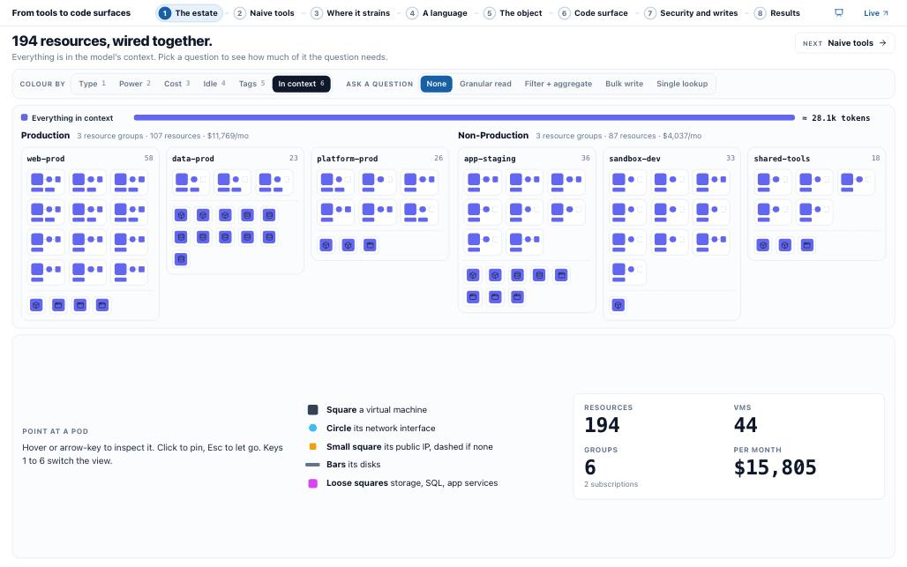

---

## ② Naive tools: one tool call at a time

**Key message.** The obvious design, one narrow tool per action, answers a three-hop question in three calls, and every turn pays again for the instructions and the whole transcript.
**Visual.** `[CHART: input and output tokens per turn, stacked by setup, question, calls and results, cached part hatched]` beside `[DIAGRAM: the estate map painting what each call touched]`

**Supporting points**
- Six narrow tools: 281 tokens of instructions and 733 for the tool definitions, sent before the model reads the question.
- Each hop needs the previous answer, so the calls cannot be batched: three calls, three turns, and one more turn to answer.
- Every turn re-sends everything so far: input per turn climbs 1,050, 1,346, 1,584, 1,821.
- The bill is ≈ 5,894 tokens for a 14-token answer: 3.6× the text that matters, and 69% of the input is setup.

| # | Do | Point at | Say | Hold |
|---|---|---|---|---|
| 1 | Open `/tour/tools` (Granular read). Click the **Setup** tab, then **You**. | Setup: "281 tokens of instructions and 733 for 6 tool definitions", and the six tool names. You: the question. The empty bars. | "Same question as screen 1. The model is given six narrow tools: list subscriptions, list groups, list resources, get one resource, update tags, set power state. That is 733 tokens of definitions and 281 of instructions, before it has read the question." | 0:20 |
| 2 | Press `→` twice (or `Space` to play). | The map: web-prod-03 lights as "full read 1", then its NIC as "full read 2". The side card lists the VM and the resources around it with how each was touched. Bars 1 and 2 grow. The Turn 2 tab holds the raw JSON of the NIC. | "Each hop needs the answer to the one before: the VM, then its NIC, then the public IP. Nothing can be batched. And every turn sends the whole conversation again. That is why the bars climb." | 0:40 |
| 3 | Press `End`. | The Answer tab: "web-prod-03 is running; its public IP is 20.103.47.219." Tiles: Billed so far ≈ 5,894 (5,801 in, 93 out); Billed + text 3.6× ("text is ≈ 1,655 tokens"); Setup share 69%. Cached input is hatched. | "Fourteen tokens of answer, about six thousand billed. Two thirds of the input is the same instructions and tool definitions, every turn. The hatched part is cached, so cheaper in real life. We count every token at full price here, to see the shape." | 0:30 |
| 4 | Optional. Click **Filter + aggregate** and flip **Route** between Broad list and Verify each VM; click **Bulk write**. Press `End` each time. | The same question is 1 call or 19, depending on the route. Bulk write is 38 calls, one write per resource. | "Same tools, bigger questions. The aggregate takes one call or nineteen, depending on which route the model picks. The bulk write takes thirty-eight, one per resource. Screen 3 lines them up." | 0:25 |
| 5 | Click **Next · Where it strains**. | | "That was one run each. Let us put the questions side by side." | 0:05 |

**Speaker notes.** Keep "turn" and "call" apart out loud: a turn is one request to the model, and its bill contains everything said so far; calls made in the same turn share it. If someone asks whether a real model behaves like this, the **How honest is this replay?** link above the chart is the answer: the scripts add numbers exactly and never mis-copy, how often a live model slips depends on the model, and screen 7 has the measured runs. Do not say the model gets the sum wrong here; the replay does not claim it.

---

## ③ Where it strains: each question strains the tools somewhere else

**Key message.** Four questions strain the catalogue in four different places, each strain has a usual fix, and a narrow question strains nothing.
**Visual.** `[TABLE: five scenarios with call maps and bills]` that opens, one row at a time, into `[DIAGRAM: the problem replayed on the left, the usual fix drawn on the right]`

**Supporting points**
- The same catalogue at its best on five questions: from ≈ 2.2k to ≈ 27.8k tokens. The runs are scripted: structure, not failure rates.
- A chain, 3 calls: follow references inside the tool (a join), 1 call.
- Arithmetic by inference, 1 call: a calculator. Exact, but 5 calls, not cheaper.
- A call per VM, 19 calls: wider calls, then filters in the tool, 1 call.
- One write per resource, 38 calls: an update with a filter, 2 calls.
- A narrow tool needs no fix. Every fix is vocabulary.

**How it moves.** A row's **problem** beat opens it and replays the important calls on the left; the right says "The usual fix is next." The **fix** beat draws the fix on the right and ticks the row. Rows you have solved stay solved. `←` takes you back to the same state, with only the fix you are leaving hidden. Every beat is in the URL as `?at=`.

| # | Do | Point at | Say | Hold |
|---|---|---|---|---|
| 1 | Open `/tour/strains`, or **Next** from screen 2. | The five rows with their call maps and bills: Follow the references (3 calls, ≈ 5,894), Broad list (1, ≈ 3,846), Verify each VM (19, ≈ 11.7k), Survey then one write per resource (38, ≈ 27.8k), One narrow tool (1, ≈ 2,239). The orange "Where it strains" labels. The empty "usual fix" boxes. The footnote "Scripted, and kind to the tools". | "The questions from screen 1 on the same catalogue, each at its best: bills from two thousand to twenty-eight thousand tokens. They do not strain it in the same place, and each has a usual fix. These are scripted and kind to the tools, so they are structural costs, not failure rates." | 0:25 |
| 2 | `→` (**Walk through them**). | Row 1 opens: three call cards. The highlighted ids, "text the model copies out of one result and into the next call". Each card says what it cost: "sent 1,050 tok", "sent 1,346 tok", "sent 1,584 tok", the same numbers as screen 2's bars. | "Problem one: a chain. Three calls, one to a turn. See the highlighted ids: the model copies them out of one result and into the next call." | 0:20 |
| 3 | `→` (**The usual fix**). | The right half fills: "Follow references inside the tool", "+ join", "1 call", "was 3". One `query_resources` call with `join nicId as nic, nic.publicIpId as pip`. Row 1 gets a tick. | "The usual fix: let the tool follow references. One query starts at the VM and crosses to its NIC and its public IP. One call, not three." | 0:20 |
| 4 | `→` (**Next: Broad list**). | Row 2 opens. The model's reply, "The model adds", with the grand total $5,461.22 and the label "no tool does this". | "Problem two: one call lists 21 VMs, 18 of them running. Then the model adds up their costs itself, in its reply, and nothing checks the sum." | 0:20 |
| 5 | `→`. | "Give it a calculator", "+ calculate(expression)", "5 calls", "was 1". "36 figures copied by the model, out of the list and into 4 calls". | "The usual fix: a calculator. The sums come out exact. But the calculator cannot see the estate, so the model copies every figure into a call: five calls where there was one. Exact, not cheaper." | 0:30 |
| 5b | Optional detour. Click **See the calculator**. | `/tour/language?rung=calculator&from=strains:4`: the whole ladder, rung 6 selected, on one screen. Rung 6: 5 calls, ≈ 5,450 billed, against ≈ 2,688 for the plain list at rung 5. Then click the **← Back to where it strains** pill at the top left. | "Here is the whole ladder for this one question. The calculator is exact and bills about twice what the plain list did: 5,450 tokens against 2,688. One more turn reads the whole list again, and every figure is written out." Back on screen 3: same beat, rows 1 and 2 still solved. | 0:45 |
| 6 | `→` (**Next: Verify each VM**). | Row 3 opens: `list_resources`, then one `get_resource` per running VM, "+ 16 more". Rows 1 and 2 stay ticked. | "Problem three: the cautious route. List the VMs, then look each running one up: nineteen calls. The catalogue allows both routes, so the bill follows whichever the model picks." | 0:20 |
| 7 | `→`. | "Wider tools, then filters in the tool", "+ filters", "1 call", "was 19". The strip of five designs: 58, 22, 40, 22, 1 calls. | "The usual fix is not one step but a ladder: fold the lookups into wider calls, then let the tool filter across VMs, so the model does not visit each one. The next screen climbs it, starting further back, from one tool per property." | 0:25 |
| 8 | `→` (**Next: Survey, then one write per resource**). | Row 4 opens: `list_resources` (194 resources, ≈ 10.2k tokens), `update_resource_tags`, `set_power_state`, "+ 35 more". "The model spells every change out itself (≈ 818 tokens of calls)". | "Problem four: a bulk write. A ten-thousand-token list, then one write per resource. Thirty-eight calls and twenty-eight thousand tokens." | 0:20 |
| 9 | `→`. | "Update everything that matches", "+ update", "2 calls", "was 38". Two filtered updates: matched 33, changed 33; matched 4, changed 4. | "The usual fix: an update with a filter says which resources match and what to set. The same job in two calls, not thirty-eight." | 0:20 |
| 10 | `→` (**Next: One narrow tool**). | Row 5, "Nothing strains": `list_resource_groups` for Production, three names, 79 tokens back. | "And a narrow question strains nothing: one call, 79 tokens back. The tool does exactly what the question asks." | 0:15 |
| 11 | `→` (**Keep it**). | The green verdict "Keep it as it is". All five rows ticked. The callout under the table: "Every fix is vocabulary." | "A narrow tool is the right design when the question is narrow. The strain starts when the questions get wider. Now look at the fixes together: a join, a calculator, a filter, an update. Each is one more thing for the model to learn and one more definition sent on every turn. Add them one at a time and you grow a query language." | 0:35 |

Then click **Fix them one at a time** for screen 4.

**Speaker notes.** Do not read the cards. The problem cards are there so you can point (the highlighted ids, "+ 16 more", the grand total) and the fix cards so you can say one sentence. The "$5,461.22" on row 2 is the problem statement, not a mistake: the script adds exactly; the point is that no tool does it and nothing checks it. The five-design strip on beat 7 is not a straight line (58, 22, 40, 22, 1): the aspect parameter makes it worse before the array makes it better. Say so; screen 4 shows why.

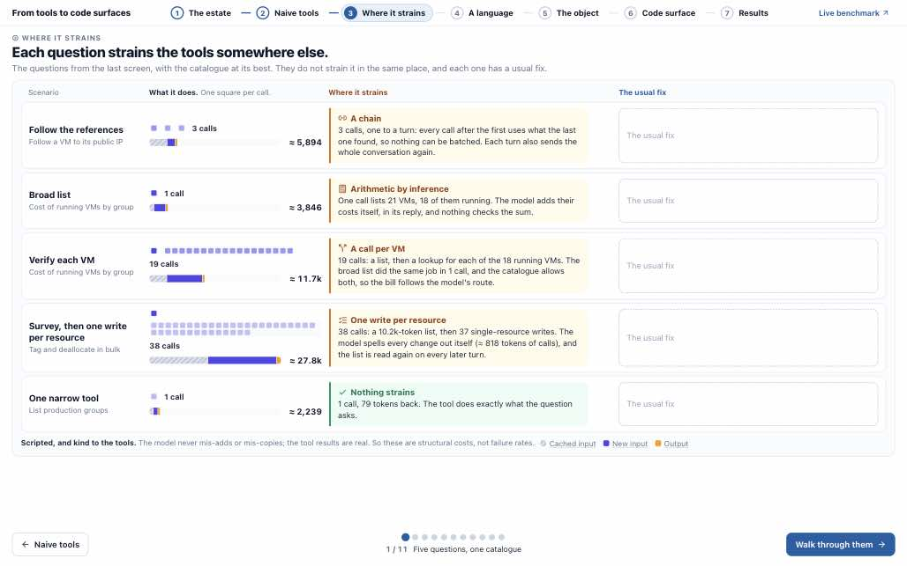

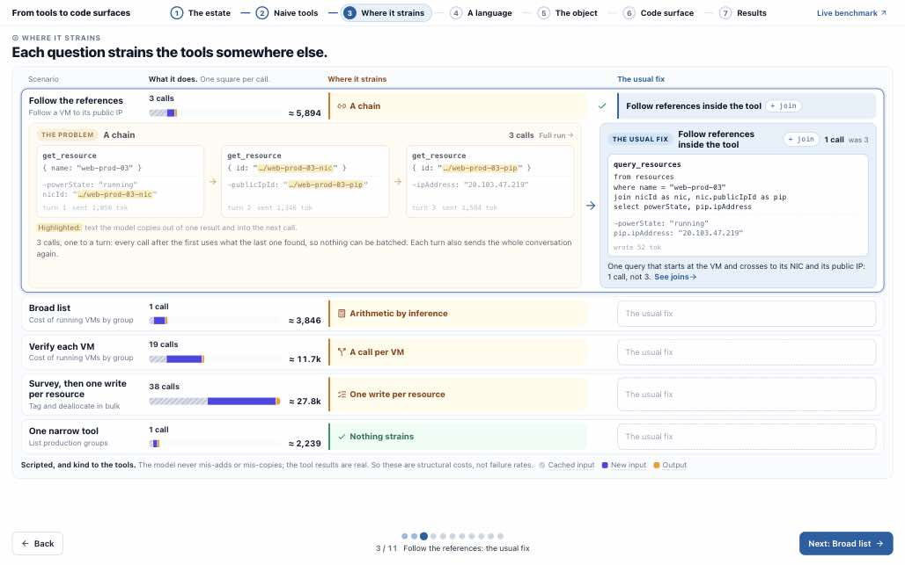

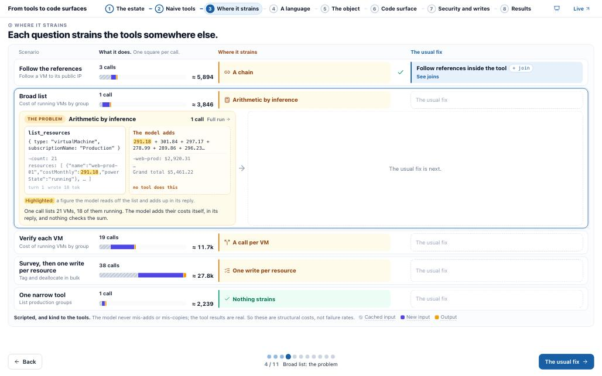

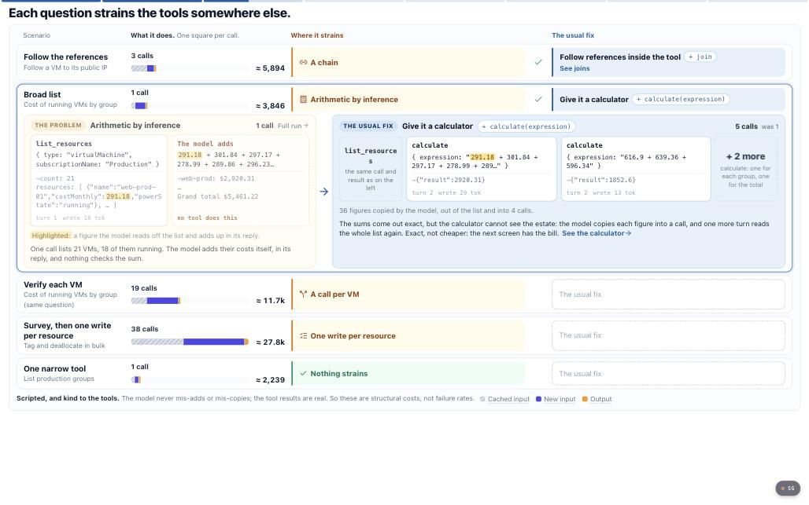

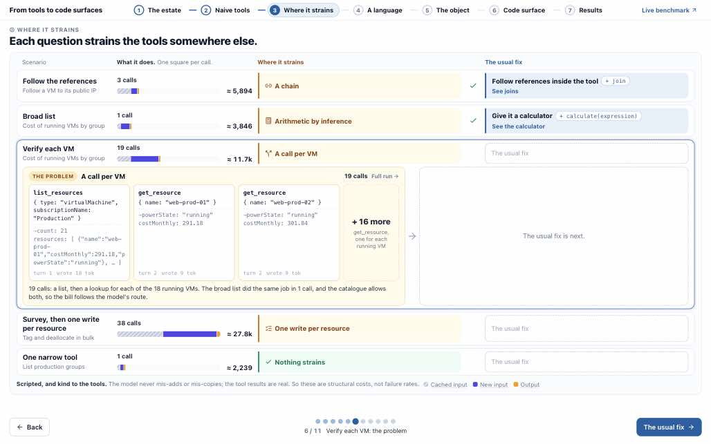

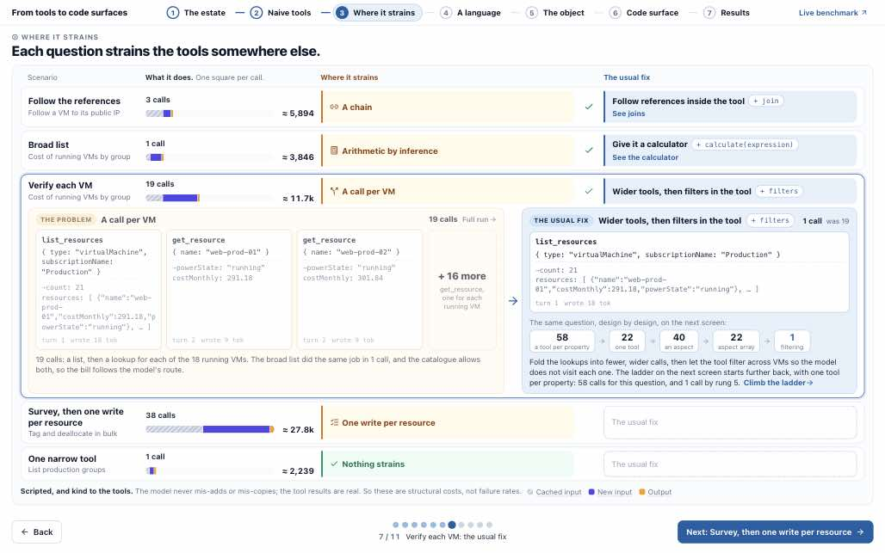

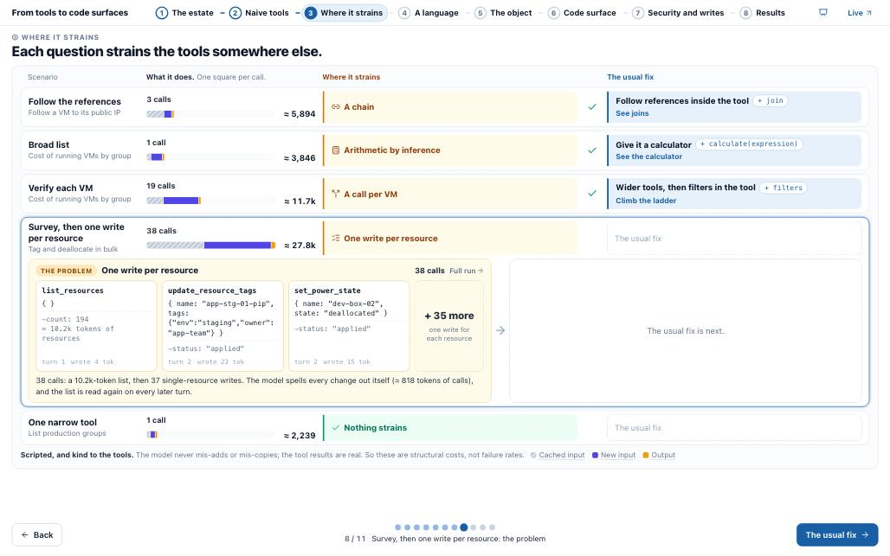

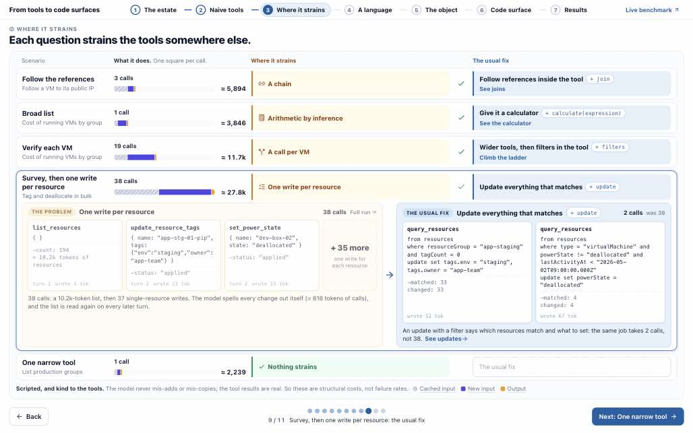

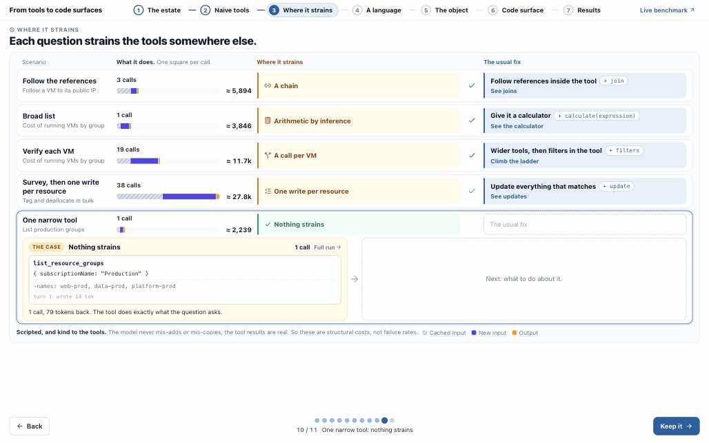

---

## ④ A language: every fix adds vocabulary

**Key message.** Push a catalogue to answer more in fewer calls and it grows, one parameter at a time, into a query language. The language stops where somebody stopped building it.
**Visual.** `[CHART: eight tool designs for one question, round trips, schema per turn and billed tokens]`, then `[DIAGRAM: language features switched on against the questions they answer]`

**Supporting points**
- One question (the cost question), eight tool designs, one answer. 58 calls and ≈ 11.2k tokens at rung 1, 1 call and ≈ 2.7k at rung 5, 2 calls and ≈ 2.1k at rung 7.
- The bills are not a straight line: the aspect parameter (rung 3) is worse than one tool (rung 2), and the calculator (rung 6) is worse than plain filtering (rung 5).
- Every feature makes the definition longer: with joins and updates on it is +49% on the first design, and it knows 32 keywords.
- Four questions nobody planned for: the language answers 0 of 4 as first built. Code answers 4 of 4.
- Rung 8 hands the model the objects and lets it write the operation. The tool definition is ≈ 1,041 tokens whatever you ask.

| # | Do | Point at | Say | Hold |
|---|---|---|---|---|
| 1 | Open `/tour/language` (rung 1), or **Next** from beat 11 of screen 3. | The question card, top right. The ladder: one row per design, with round-trip squares, schema per turn and billed bar. Rung 1: 58 calls, ≈ 1,137 schema, ≈ 11.2k. The right panel: the 15 tools the model is given, and the turn-by-turn bill. | "One question, the cost question, put to eight tool designs. All eight reach the same answer. Design one is the obvious one: a tool per property. Fifty-eight calls." | 0:20 |
| 2 to 5 | `→` four times (or `↓`), about ten seconds each. | The yellow box under the ladder: what pushes you from this rung to the next. Rung 2: 22 calls, ≈ 7,756. Rung 3: 40 calls, ≈ 9,179. Rung 4: 22 calls, ≈ 5,203. Rung 5: 1 call, ≈ 2,688. | Read each cause in one breath. "Every fact is its own round trip, so you consolidate. A tool returns a few hundred tokens when you need a power state, so you add a parameter. A slice still takes two calls for two aspects, so you make it an array. It still visits one VM at a time, so you add filtering across VMs." | 0:40 |
| 6 | `→`. | Rung 6, the calculator: 5 calls, ≈ 5,450. The box: "Exact, but not cheaper: it bills ≈ 5,450 tokens against ≈ 2,688 for the plain list." (Arrive here from screen 3 and the pill "← Back to where it strains" is at the top left.) | "The calculator from screen 3. Exact now, and not cheaper. It cannot see the estate, so the arithmetic has to move next to the data." | 0:20 |
| 7 | `→`. | Rung 7, a query language: 2 calls, ≈ 2,138, the cheapest row. The box: "You have built a query language." | "So the filter grows: grouping, aggregation, only some fields. You have built a query language. For this question it is the cheapest row on the page, because it was built for this question." | 0:20 |
| 8 | `→` (**Next: Grow the language**). If you did not arrive from screen 3, switch **Follow references** and **Updates** on. | Four feature switches on the left. The middle column: the four benchmark tasks, going green. Top right: Definition ≈ 987 (+49% on the first design), Keywords to learn 32 (4 more), Benchmark tasks 4 of 4. The bar: `query_resources` = 987 against code tool = 1,041. **Try a query** with **Run**. | "Here is the language we just built. Each feature answers one more question and makes the definition longer. With follow-references and updates on it takes all four of our benchmark tasks, in about a thousand tokens of definition." | 0:30 |
| 9 | `→` (**Next: What it cannot answer**). Then click **Turn on "Follow references"**, and **Turn on "Computed values"**. | Four questions nobody planned for. Left, red: "The language refuses it", each naming the feature it would need. Right, green: "Answered by code, 2 ms" (or 1 ms). Counters: 0 of 4 in the language, 4 of 4 in code. After the first switch: 1 of 4, "The language answers it", "16 rows come back, the same as the code finds." After the second, cost per vCPU still refuses: `Unsupported compute function "divide". Supported: daysSince.` | "Four questions nobody planned for. The language refuses every one, and each refusal names the feature it would need. Turn one on and that question works. Turn computed values on and the vCPU question still fails: the feature only knows days-since. Every new kind of question is another feature. The same questions as ordinary code just run." | 0:35 |
| 10 | `→` (**Next: Code over the object**). | Rung 8: 1 call, ≈ 3,468, schema ≈ 1,312. The box: "On this question its bill is higher than the query language's... the tool definition is the same ≈ 1,041 tokens whatever you ask." | "The eighth design is not another tool. It hands the model the objects, and the model writes the operation. On this question it is not the cheapest: the query language was built for it. But the definition stays the same whatever you ask, and filter, group, sort and divide are things the model already knows." | 0:25 |

Then click **Reshape the estate into an object** for screen 5.

**Speaker notes.** The honest line is the box on rung 8: the code surface is not the cheapest on this question and the talk never says it is. The case is breadth (beat 9) and, at the end, weaker models (screen 7). The number to keep straight: 1,312 is instructions plus the tool, 1,041 is the tool's definition alone, and 987 is the query tool with join and update on. The code tool's definition is longer than the six narrow tools' (1,041 against 733 tokens): you pay it every turn, but it does not grow with the questions.

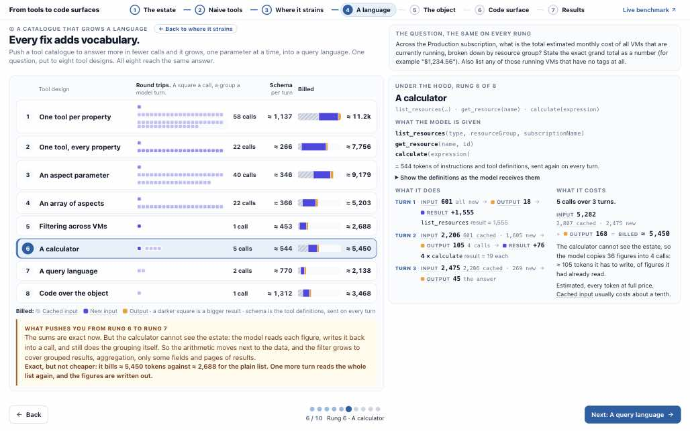

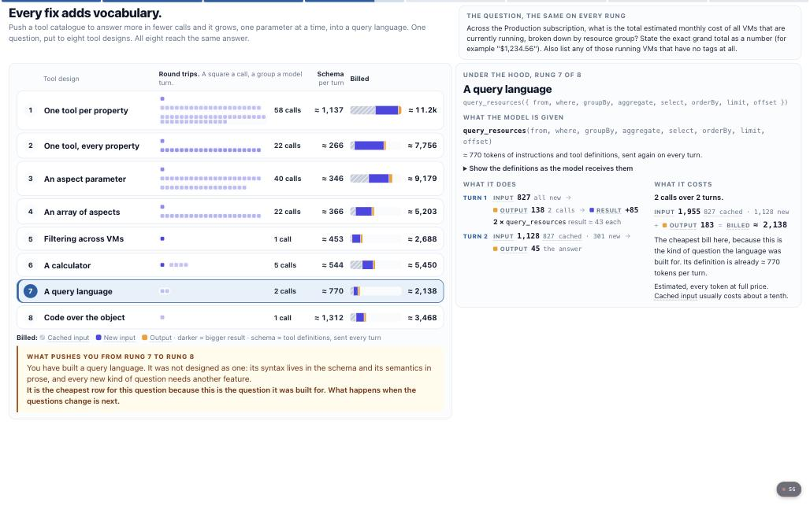

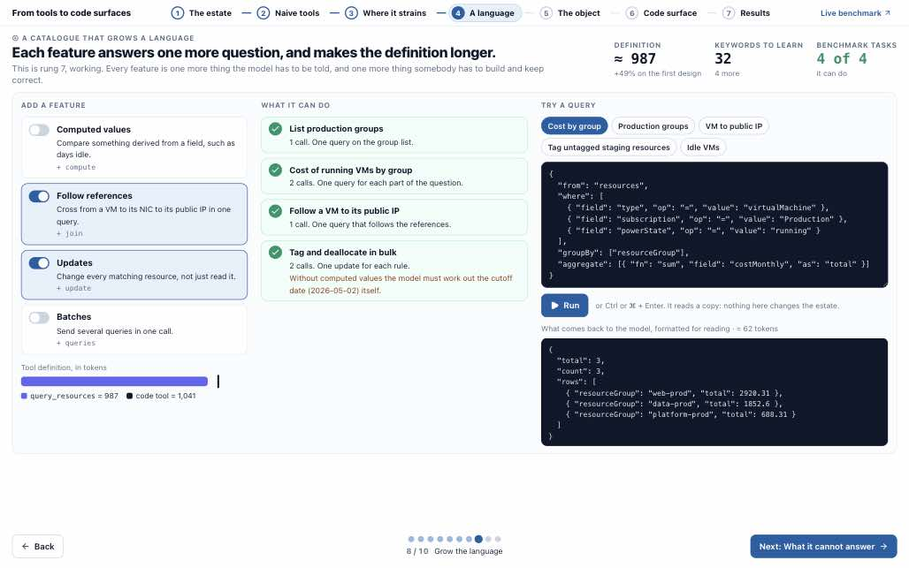

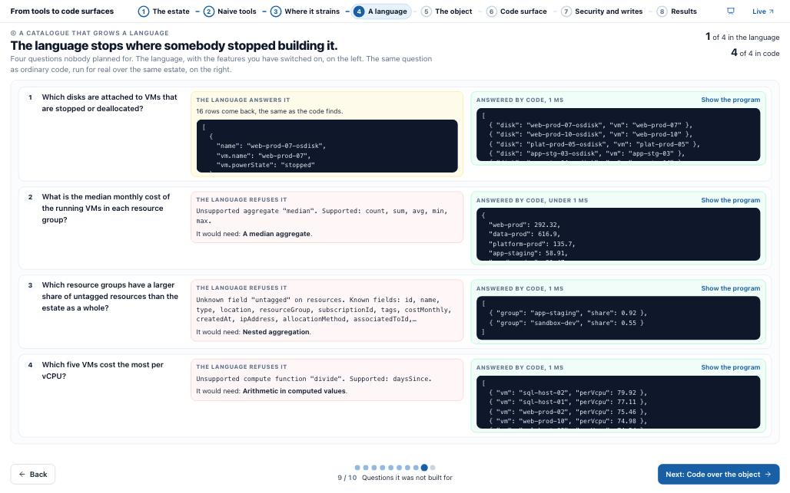

---

## ⑤ The object: stop adding tools, reshape the estate

**Key message.** Turn the 194 resources into one plain object, tell the model its shape once, and let it write the program. Only the answer goes back.
**Visual.** `[DIAGRAM: the estate map morphing into the data object, then the program running over it with counters]`

**Supporting points**
- Reshape: containers become short lists, lines become ids, and the pods dissolve into one flat list. Nothing in the object nests.
- Describe: the model is told the shape once, in the tool definition (≈ 1,041 tokens). It never receives the records, and internal fields are left out of the object.
- Read: one tool call, however many steps the question needs. This is the benchmark's own reference program.
- The runtime reads 194 records and uses 3. The model sees ≈ 40 tokens.

Two ways through. **Stepped:** `→` once per step. **Played:** press `Space` on step 1 and talk while it runs (about half a minute); `Space` pauses.

| # | Do | Point at | Say | Hold |
|---|---|---|---|---|
| 1 | Open `/tour/object`, or **Next** from beat 10 of screen 4. Act: Reshape. | The estate map with web-prod-03 outlined, and the empty `{ } data` on the right: subscriptions [0], resourceGroups [0], resources [0]. The question bar: "power state and public IP of web-prod-03". | "Every fix so far added an interface for the model to learn. Change what it works on instead: turn all 194 resources into one plain object." | 0:15 |
| 2 | `→`. | The two subscriptions and six groups slide into two short lists. | "Two subscriptions and six resource groups become two short lists. A group keeps the id of its subscription instead of sitting inside it." | 0:10 |
| 3 | `→`. | The lines from web-prod-03 to its NIC and from the NIC to its public IP. | "web-prod-03 does not contain its NIC. It holds the id of one, and the NIC holds the id of its public IP. What the estate draws as lines, the object stores as ids." | 0:15 |
| 4 | `→`. | 194 cells fill the resources list. The pods fade. | "Every resource becomes one record in one list, web-prod-03's pod included. The pods were only a drawing: nothing in the object nests." | 0:15 |
| 5 | `→` (act: Describe). | The dark panel, "tool definition, as sent to the model", "≈ 1,041 tokens in all": `type Projection`, the note about references. Under it "Left out of the object": `_internalId` and `_billingAccount`, "stored on every resource, never projected". On the right, the three records this question needs, joined by arrows. | "The model is told this shape once, in the tool definition. It never receives the 194 records; the runtime keeps them. And the fields we do not want it to see are not in the object at all." | 0:25 |
| 6 | `→` (act: Read). | The reference program appears under `operate_inventory({ code })`, "1 tool call". | "To answer, the model writes a small program: one tool call, however many steps the question needs. This is the benchmark's own reference program." | 0:15 |
| 7 | `→`. | Lines 2 and 3 highlight. The counter "Scanned in the runtime", "194", "records read, no tokens". | "Index every record by id. It runs inside the runtime: 194 records read, no model turn." | 0:10 |
| 8 | `→`. | The find line highlights. A "found" marker on one cell: "name read on 15 records, stopped at [14]". | "Find web-prod-03. It reads 15 names and stops at resources[14], the first match." | 0:15 |
| 9 | `→`. | The NIC record lights. | "The VM holds the id of its NIC, so the NIC is one lookup away: a key, not a search, and not another tool call." | 0:10 |
| 10 | `→`. | The public IP record lights. | "The same again for the public IP, then read its address. Two lookups, no extra model turn." | 0:10 |
| 11 | `→`. | The counters: Scanned 194, Records it used 3 of 194, Back to the model ≈ 40. The card "Back to the model": `{"powerState":"running","publicIp":"20.103.47.219"}`. | "Only the answer goes back to the model: two values, about forty tokens. The 194 records never entered its context. Screen 2 spent about six thousand tokens on the same question." | 0:20 |

Then **Next · Code surface** for screen 6.

**Speaker notes.** This is the screen to slow down on if you cut anything else. The ≈ 40 tokens are the tool message that goes back to the model; the 14 tokens on screens 1 and 2 are the model's final answer text. Different things, both true.

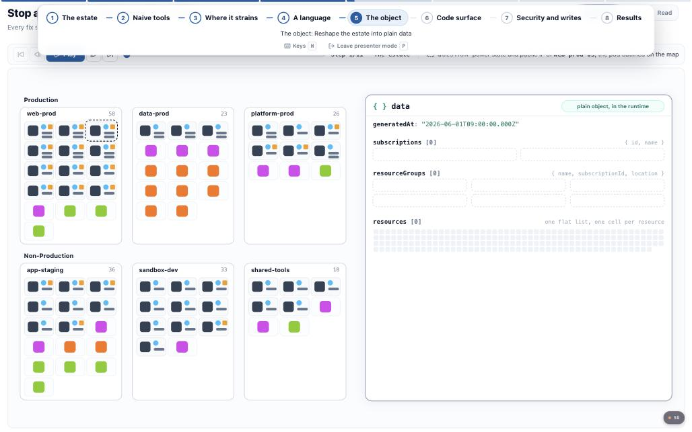

![⑤ step 8: find web-prod-03, stop at resources[14]](tour-script/s5-7-find.jpg)

---

## ⑥ Code surface: any question is one program

**Key message.** The same object and the same one tool take a sum, a write for review and questions nobody planned for. The contract decides what a program can see, change and run.
**Visual.** `[DIAGRAM: the program on the left, the same object on the right, scan counters and the bill underneath]`

**Supporting points**
- Cost by group: 25 lines, 394 field reads, 18 records used, ≈ 63 tokens back, and about the same bill as the catalogue's best case. No win here.
- Tag and deallocate: a rule, not a list. 70 field changes on 37 resources, ≈ 97 tokens back, applied only after review.
- Disks of stopped VMs and cost per vCPU: questions the query language could not take. Nothing was added to the tool surface.
- A narrow lookup: a narrow tool does it for less. The screen says so.
- Try to break it: internal fields do not exist, fields outside an allowlist are read-only, runs get a time limit.

Each example is three beats: **Write**, **Run**, **Answer**. The write example has a fourth, **Review**. `→` steps through all 19; the picker at the top right jumps between examples. `?ex=` and `?step=` are in the URL.

| # | Do | Point at | Say | Hold |
|---|---|---|---|---|
| 1 | Open `/tour/code` (Cost by group, Write), or **Next** from step 11 of screen 5. | The question card. The 25-line program. The same `data` object on the right, with empty counters. | "Same object, same one tool, a bigger question: the cost question from the ladder, as one program. It picks Production's running VMs, adds their cost up per resource group and lists the untagged ones. The model never sees a record." | 0:15 |
| 2 | `→` (**Next: Run**). | The program lights up. The resource strip: rings are read, dashed are used. Counters: Scanned 194 (394 field reads, no tokens), Records it used 18 of 194. | "The runtime runs it where the data lives. 194 records scanned, not one sent to the model. The 18 that pass every filter, the running VMs in Production, are the ones it adds up." | 0:12 |
| 3 | `→` (**Next: Answer**). | Back to the model, ≈ 63 tokens, and the JSON. The strip at the bottom: Catalogue best case 3,846 tokens, 1 call; Code surface 3,468 tokens, 1 call. "About the same bill on both surfaces." | "Only the answer goes back, about 63 tokens. The program added the totals up, so there is no sum for the model to get wrong. And the bill is about the same as the catalogue's best case: one call that happens to carry what this question needs. Not a win here. The win is elsewhere." | 0:18 |
| 4 | `→` (**Next example: Tag and deallocate**). | The program has two rules. The tool header now reads `operate_inventory({ code, rationale })`. | "The write question, as a rule: tag what is untagged in app-staging, deallocate the VMs that sat idle. The model sends the rule and a one-line rationale, not a list of thirty-seven resources." | 0:12 |
| 5 | `→`. | Counters: Scanned 194 (609 field reads), Proposed changes 70 fields on 37 resources. | "It runs on a copy of the estate, and the runtime compares before and after: 70 field changes on 37 resources, and nothing else moved." | 0:10 |
| 6 | `→`. | Back to the model, ≈ 97 tokens, "the summary it needs". | "The model is told just enough to write its summary, about 97 tokens. The 70-field change set stays in the runtime." | 0:08 |
| 7 | `→` (**Next: Review**). Click **Approve and apply**; click **Undo**. (Or **Decline**.) | The change set card, "waiting for a person": `app-stg-01-pip + env=staging + owner=app-team`, `dev-box-02 powerState stopped → deallocated`, "37 resources, 70 fields · tags on 33 resources · power state on 4". After Approve: "Approved: the 37 resources now carry the change, in this copy of the estate." After Decline: "Declined: nothing changed. The estate is exactly as it was." | "Nothing is applied until a person reviews the change set: 37 resources, 70 fields. Approve and it lands in this copy of the estate. Decline and nothing changes." | 0:15 |
| 8 | `→` (**Next example: Disks of stopped VMs**). | The 8-line program. | "A question the query language was not built for: which disks belong to stopped or deallocated VMs? It has to follow a reference. As code it is eight lines, written like any other program." | 0:10 |
| 9 | `→`. | Counters: 194 scanned (546 field reads), 32 records used. | "Same runtime, new question. 194 records scanned, with a lookup by id for each disk's VM. 32 records end up in the answer: the disks and their VMs." | 0:08 |
| 10 | `→`. | Back to the model ≈ 248 tokens. The three boxes along the bottom: red, "The query language from the last screen, as first built", `Refused: Unknown parameter "join". This tool does not support it.`; "What it would take", "A new feature, Follow references, and a longer description for the model to learn."; green, "The code surface", "Answered with the one tool it already has". | "Sixteen disks come back, about 250 tokens. Nothing was added to the tool surface for this question. The language from the last screen refuses it. Code does not need a feature." | 0:12 |
| 11 | `→` (**Next example: Cost per vCPU**). | The short program: filter, map, sort, slice. | "Another nobody planned for: which five VMs cost the most per vCPU? Dividing and sorting is what the model already writes fluently, so it does not need a calculator tool either." | 0:06 |
| 12 | `→`. | 194 scanned, 5 records used. | "The program divides cost by vCPUs for every VM and sorts. Five VMs reach the model, by name." | 0:06 |
| 13 | `→`. | Back to the model ≈ 79 tokens. Red box: `Refused: Unknown parameter "compute". This tool does not support it.` | "Five rows, about 79 tokens. The program did the dividing, so there is no arithmetic for the model to get wrong." | 0:08 |
| 14 | `→` (**Next example: A narrow lookup**). | The 10-line program. | "A narrow question: how many resource groups does Production have, and what are they called? Ten lines, and not one resource record involved." | 0:08 |
| 15 | `→`. | Counters: "6 groups" read, "3 of 6" used. | "It reads six resource groups and no resource record. Three of them are Production's." | 0:08 |
| 16 | `→`. | Back to the model ≈ 42 tokens. The strip: Catalogue best case 2,239 tokens, 1 call; Code surface 3,032 tokens, 1 call. "Here the catalogue wins: the code surface is billed 1.4× the tokens of one narrow tool." | "Three names, 42 tokens. A narrow tool would have done this too, and for less: the code surface is billed 1.4 times as much here, because it has to describe the whole object first. I would rather show you where it does not win." | 0:14 |
| 17 | `→` (**Next example: Try to break it**). The See beat has **Read internal fields** loaded. | The program reads `vm._internalId` and `vm._billingAccount`. Back to the model: only `name`. The lead: "They are not blocked; they do not exist." | "Now try to break it. Read internal fields. The projection left them out before the code ran, so they are not blocked. They do not exist." | 0:13 |
| 18 | `→` (**Next: Change**). **Change a cost** is loaded. Optional: click **Add a tag** and **Stop a VM** (allowed, one field on one resource, proposed for review), then **Tag with a number**, **Invent a field**, **Delete a resource** (refused). | Red box, ≈ 27 tokens: "error: web-prod-03: costMonthly is read-only". The counters: "Records it used", "0", "nothing was applied". | "Change a cost: every field outside the allowlist is read-only. One bad edit rejects the whole proposal, and nothing is applied." | 0:13 |
| 19 | `→` (**Next: Do**). **Loop forever** is loaded; click **Call the network** too. | Red box: "Stopped after 1500 ms. The run took too long, so its worker was terminated." For the network: "Network APIs are not on the allowlist." | "Loop forever: runs get a time limit, the worker is terminated and nothing else is affected." On the network probe, read the screen's own words: "Demo-level only: this runtime is not a security boundary." | 0:14 |

Then **How it holds up** for screen 7. In any beat you can edit the program in the dark panel and press **Run** (`Ctrl/⌘+Enter`) to try your own.

**Speaker notes.** Be straight about the scoreboard on this screen, because the audience can see it. Cost by group is a tie, the lookup is a loss (1.4×), the tag question is the clear token win, and what the code surface buys you on the rest is breadth: no new feature, no calculator, no per-resource writes. Approve and Decline act on the tour's own copy of the estate only. Never call the sandbox safe: the screen says it is not a security boundary, and the README's "Execution and isolation" section says what a production boundary needs.

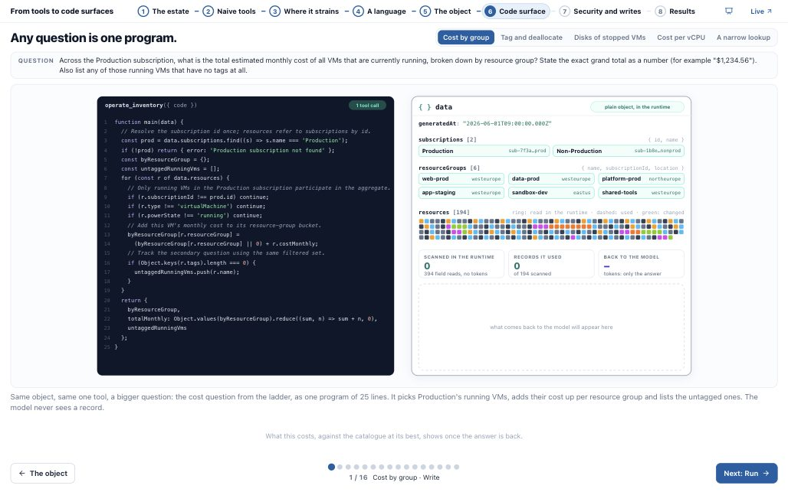

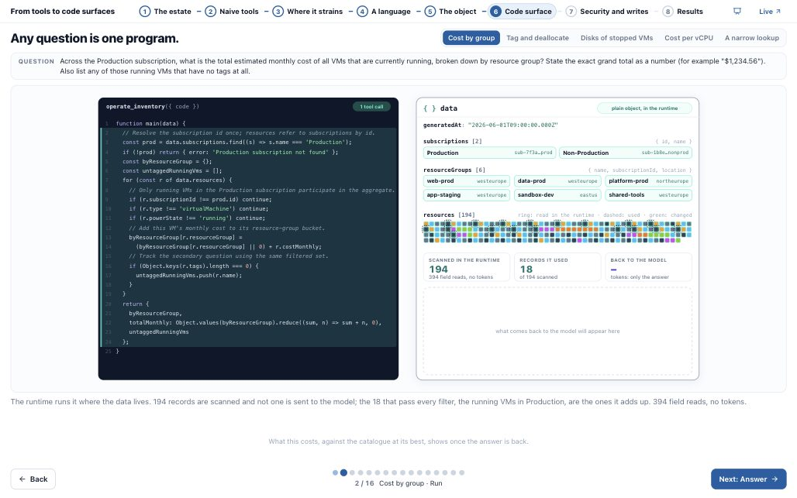

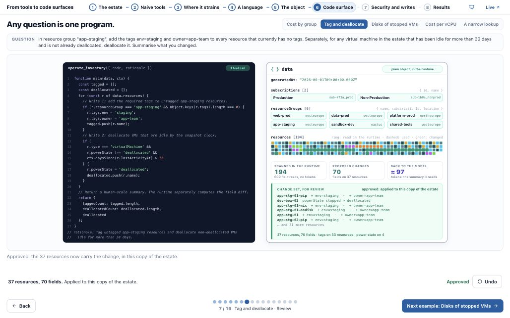

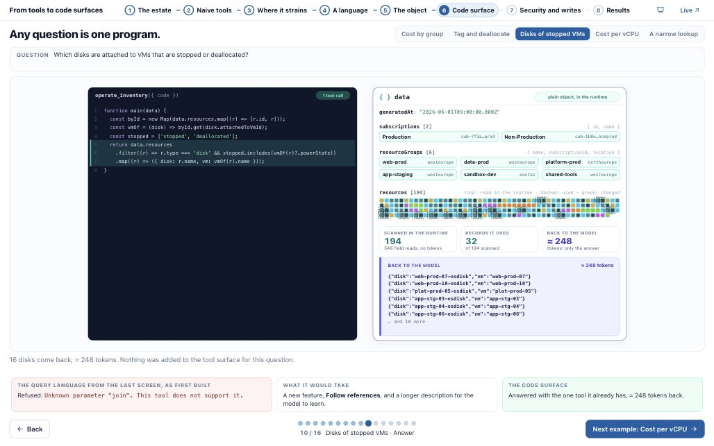

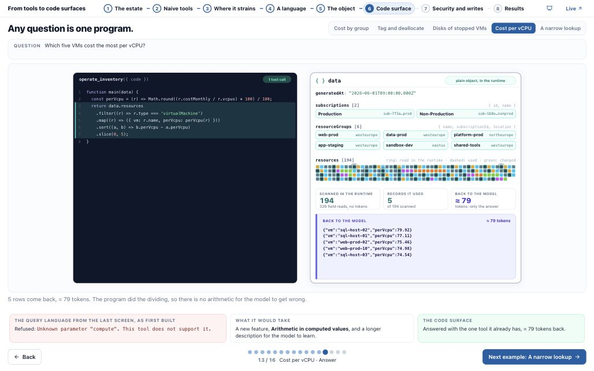

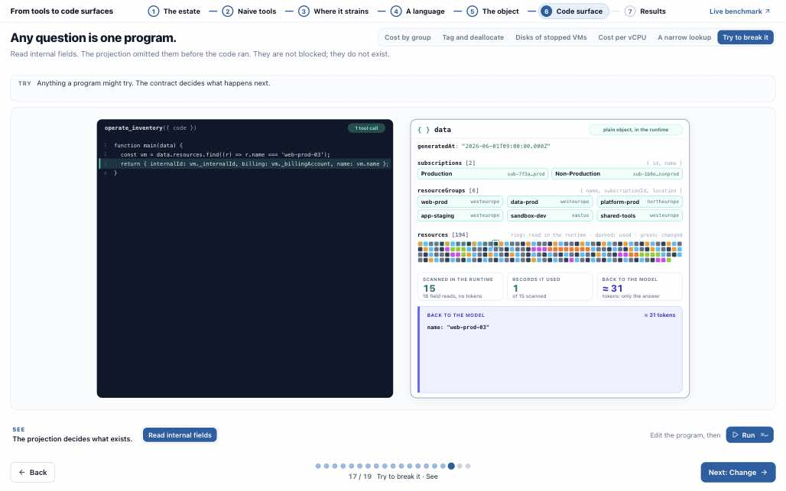

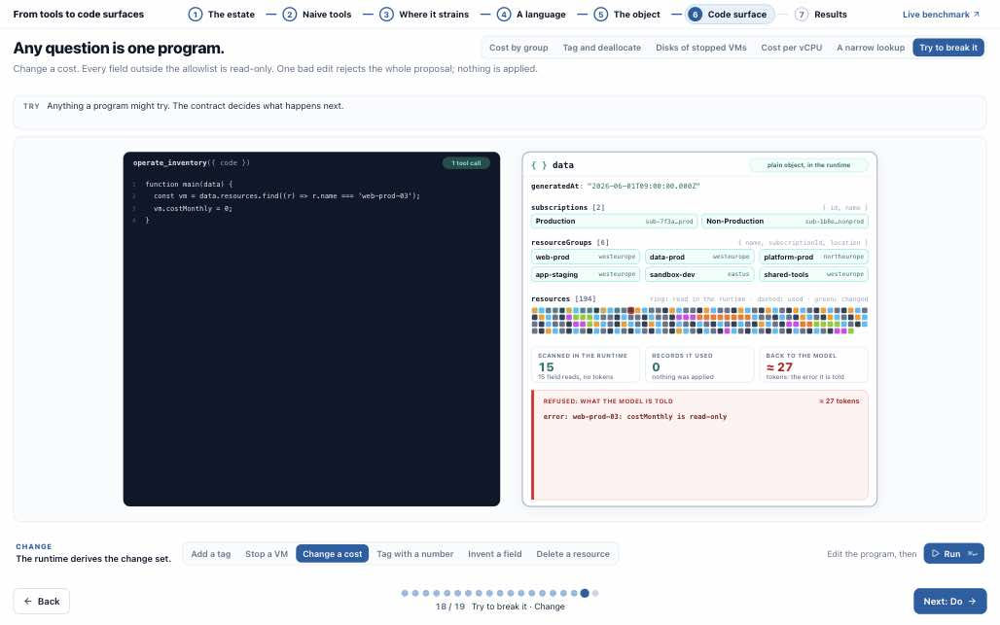

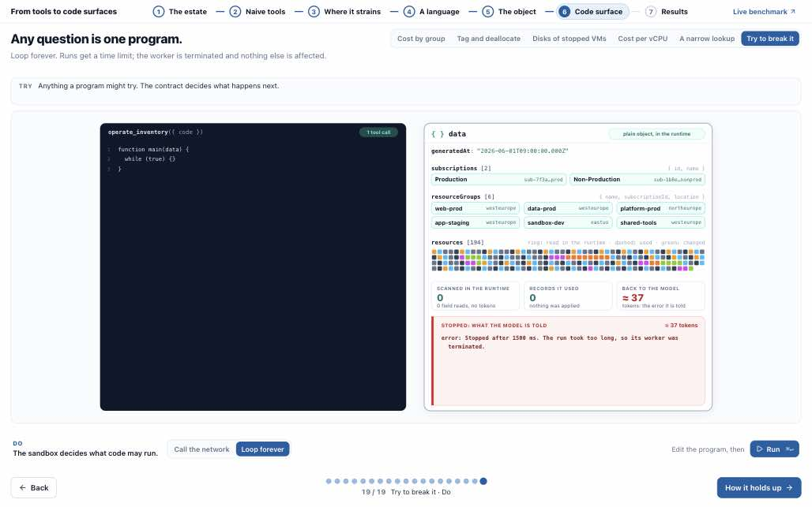

---

## ⑦ Results: a weaker model breaks the other methods, not this one

**Key message.** Across three models the code surface gets 80 of 80 right on all of them and is the cheapest right answer on each. The other five methods fall as the model gets weaker.
**Visual.** `[CHART: three panels, one per model, six methods each; the bar is right answers out of 80, the figure beside it is dollars per 1,000 right answers]`

**Supporting points**
- Every bar is 80 runs: 8 tasks, 10 repetitions. Pink is the wrong answers.
- Newer models (gpt-6-luna, gpt-5.6-luna): the other five methods get 76 to 80 of 80. Accuracy hardly separates them, so cost does: $0.286 and $0.744 per 1,000 right answers for the code surface, against $0.387 and $0.838 for the next cheapest.
- Older model (gpt-5.4-mini): the code surface is still 80 of 80 ($2.66 per 1,000 right). The other five fall to between 39 and 56 of 80 (next cheapest $4.09 at 56).
- A better model and a better method are separate effects and they multiply: 13.3× × 4.90× = 65.4× per right answer between the dearest and the cheapest.
- Why it holds is a reading, not a measurement. The screen says which is which.

| # | Do | Point at | Say | Hold |
|---|---|---|---|---|
| 1 | Open `/tour/results`, or **How it holds up** from screen 6. | Two panels lit (gpt-6-luna, gpt-5.6-luna), the third held back ("Next: the older model"). The six methods in three groups: Catalogue (called one by one, plus a calculator, called from a program), Tuned catalogue (called one by one, called from a program), Code surface (a program per question). Tiles: Code surface 80 of 80; the other five 76–80 of 80; cheapest right answer. | "Start with the two newer models. Almost every method works: the other five get 76 to 80 right out of 80, and the code surface gets 80. Accuracy hardly separates them, so cost does: 29 cents per thousand right answers on the newest model, against 39 cents for the next cheapest." | 0:40 |
| 2 | `→` (**Next: an older model**), or **An older model**. | The third panel lights: gpt-5.4-mini. Pink is the wrong answers: the bars shorten, 39, 49, 56, 54, 49 of 80. The code surface stays 80 of 80, $2.66. The tile: next cheapest $4.09 at 56 of 80. | "Now an older, smaller model. The code surface is still at 80 of 80. The other five methods fall to between 39 and 56. This is the point of the talk: as the model gets weaker the catalogue approaches fall, and the code surface does not." | 0:45 |
| 3 | `→` (**Next: what a right answer costs**), or the **Dollars** switch. | The dollars per 1,000 right answers enlarge. The tiles: 13.3× for the model alone, 4.90× for the method alone, 65.4× together. | "What a right answer costs, failures included: the code surface is the cheapest on all three models. A better model and a better method are separate effects, and they multiply. Between the dearest and the cheapest right answer it is 65 times." | 0:30 |
| 4 | `→` (**Next: why it holds**), or the **Why it holds** switch. | Left: "Why the code surface holds", with each line tagged Reading or Measured. Right: "What this does not show". | "Why? A reading, not a measurement: models write code fluently, and the object tells them what the data looks like. Programs over the catalogue have nothing like that to read. And one thing we did measure: code alone did not hold. On the older model, programs over the catalogue got 56 of 80, and over the tuned catalogue 49. On the right, what this does not show." | 0:50 |

Then **Run the live benchmark**: the ask.

**What the right column says, so you can say it first.** On gpt-6-luna accuracy ties: the smallest p-value against the code surface is 0.12, so there it saves money, not mistakes. One mock estate of 194 resources, eight tasks, ten runs each: larger estates and other vendors' versions of programmatic calling are untested. A single narrow lookup is the one place a direct call wins, at about 0.6× the tokens. Dollars are estimates from the tokens the provider reported, not an invoice. Hosted programmatic calling, run on the two newer models only, got 79 to 80 of 80 and is left off the chart.

**Speaker notes.** The weaker-model result is the talk's strongest claim and the one thing that is measured. Say it in that order: measured first (beats 1 and 2), the reason second and labelled as a reading (beat 4). Do not say the code surface is more accurate on the newer models (it ties) or that code in general holds (it did not, without the object). The "pre-trained on code" explanation is yours to give, and the screen gives it as a reading beside the measured fact that programs over the catalogue did not hold.

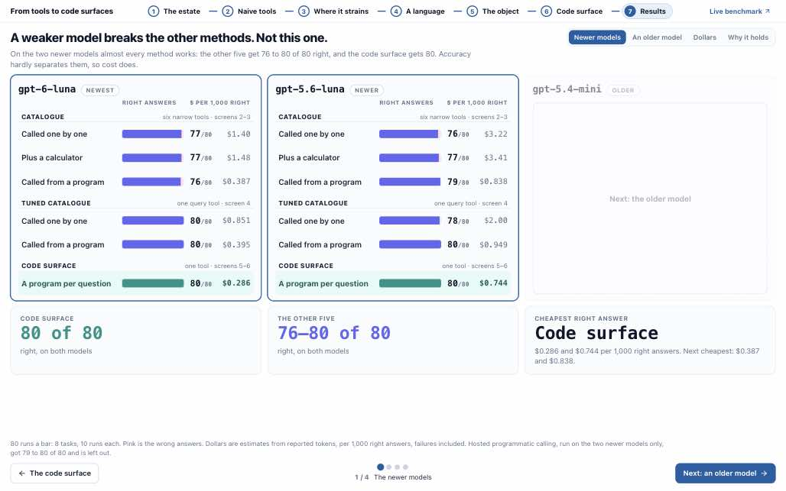

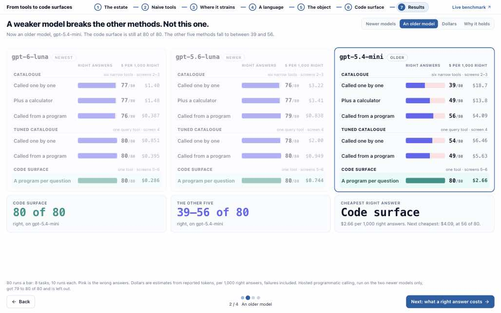

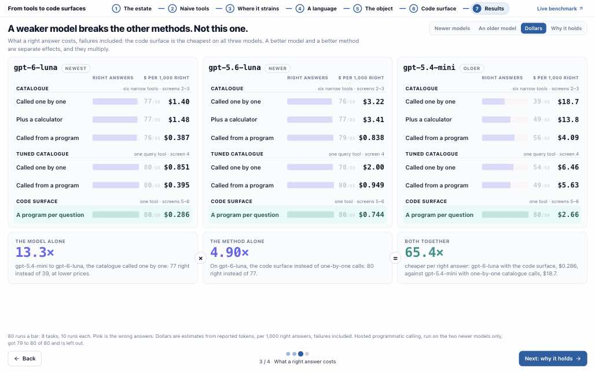

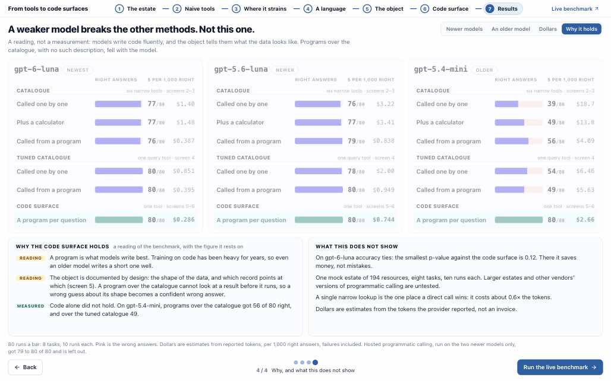

---

## Replay sheet

Every beat as a URL, so a replay can start anywhere. Paste into the address bar; the dev server is `http://localhost:5173`.

| Screen | Beat | URL |
|---|---|---|
| ① | start; with the cost lens and Granular read | `/tour/estate`; `/tour/estate?lens=cost&q=granular-read` |
| ② | question, answer turn | `/tour/tools`; `/tour/tools?step=4` |
| ② | the cautious route; the bulk write, ten per turn | `/tour/tools?task=filter-aggregate&route=survey`; `/tour/tools?task=bulk-write&batch=10` |
| ③ | beats 1 to 11 | `/tour/strains?at=0` to `/tour/strains?at=10` |
| ④ | rungs 1 to 8 | `/tour/language`, `?rung=one-tool`, `?rung=aspect`, `?rung=aspects`, `?rung=filter`, `?rung=calculator`, `?rung=query`, `?rung=code` |
| ④ | grow, with join and update on; limits; the way back to screen 3 | `/tour/language?stage=grow&f=join,update`; `/tour/language?stage=limits`; add `&from=strains:4` for the pill |
| ⑤ | steps 1 to 11 | `/tour/object?step=0` to `/tour/object?step=10` |
| ⑥ | cost, beats 1 to 3 | `/tour/code`, `/tour/code?step=1`, `/tour/code?step=2` |
| ⑥ | the other examples (`ex` is `tag`, `disks`, `ratio`, `lookup`, `break`; `step` 0 to 2, and 0 to 3 for `tag`) | `/tour/code?ex=tag&step=3`, `/tour/code?ex=lookup&step=2`, `/tour/code?ex=break&step=1` |
| ⑦ | beats 1 to 4 | `/tour/results`, `?show=older`, `?show=dollars`, `?show=why` |

---

## The 10-minute cut

| Screen | What to do | Min |
|---|---|---|
| ① | Beats 1 and 4 only. | 0:50 |
| ② | Beats 1 and 3: the question, then `End`. | 0:50 |
| ③ | Jump with the dots (or `→` fast) to beats 1, 3, 5, 9 and 11. Skip the detour. | 2:00 |
| ④ | Rung 1, rung 7, the limits stage, rung 8. | 1:30 |
| ⑤ | Press `Space` at step 1 and talk over the run. | 0:40 |
| ⑥ | Beat 3 (cost answer), beat 7 (review), beat 17 (break it). | 1:15 |
| ⑦ | Beat 2 (the older model) and beat 3 (dollars). | 1:20 |

About 8:25 plus transitions.

---

## Questions you will get

**Isn't this just programmatic tool calling?** Screen 7's rows "Called from a program" are exactly that: programs over the catalogue tools. On the two newer models they do well (76 to 80 of 80) and cost little. On the older model they fall to 56, and to 49 over the tuned catalogue, while the code surface stays at 80. The reading is that the object tells the model what the data looks like and the catalogue gives it nothing to read. Hosted programmatic calling was run on the two newer models only (79 to 80 of 80) and is off the chart.

**Is the sandbox safe?** No claim is made. Screen 6 says "Demo-level only: this runtime is not a security boundary." The README's "Execution and isolation" section says what a production boundary needs. What the demo shows is the contract: what the model can see (the projection), what it can change (an allowlist and a change set for review) and what it can run (a time limit).

**What about writes?** Screen 6, the tag example. The program proposes, the runtime computes the change set from a copy of the estate, and a person approves. Approve and Decline act on the tour's copy only.

**Does it scale to a bigger estate?** Not measured. One mock estate, 194 resources. The runtime reads records without spending model tokens, but the shape of the data still has to fit in the tool definition.

**If the query language is cheapest on the cost question, why not use it?** On that question it is the cheapest (2,138 against 3,468). It loses on breadth: 0 of 4 on the questions nobody planned for, and every feature that fixes one question lengthens the definition for all of them (+49% with join and update on).

**Why is the code tool's definition bigger than six narrow tools'?** 1,041 tokens against 733, because it describes the data. It stays the same whatever you ask. The language's grows with every feature.

---

## What the walk-through found

Walking the tour as a talk showed where the narrative and the visuals disagreed. Each of these is fixed, and most are pinned by a test.

| Where | What did not line up | What changed |
|---|---|---|
| ③ | The replay of each problem lived on screen 2, so showing a problem meant leaving the screen and coming back. | Each row opens into the problem on the left and the usual fix on the right. Rows stay solved, `←` returns to the same state, and the beat is in the URL. |
| ③ to ④ | **See the calculator** led to a screen that had to hold a lot of state, and there was no clean way back. | The link lands on rung 6 of the ladder, on one screen, with the pill "← Back to where it strains" returning to the same beat with the same rows solved. |
| ④ | The screen did not fit: the ladder, the grow-a-language demo and the limits all lived on one page. | Ten beats on three stages, each exactly one screen tall. |
| ⑥ | It read as a new page after ⑤ instead of its continuation. | Same two panels as ⑤, one example per Write, Run, Answer. |
| End | The benchmarks were not at the end, and there was no measured claim anywhere. | Screen 7, the only measured one, built from a snapshot of saved runs on three models. |
| ② | The lessons said the models were "off by 5–11% every time" and the bill "swung by 60%". Screen 7 shows newer models getting 76 to 77 of 80 on those methods, and the tour promises no failure rates before it. | The lessons are structural. The honesty note points to screen 7 for measured runs. |
| ③ | The calculator card quoted ≈ 5,450 against ≈ 2,688 while the row's own bill said ≈ 3,846: two totals for one question side by side. | The card quotes no bill; the ladder on screen 4 carries the comparison. |
| ③ | The fan-out card said "58 calls to 1" next to a row that said 19 calls. | It says the ladder starts further back, with one tool per property, and labels both numbers. |
| ⑥ | "The totals are exact", while the answer shows `688.3100000000001`. | "The program added the totals up, so there is no sum for the model to get wrong." |
| ⑦ | A bullet pointed to "screen 6" for the narrow lookup at 0.6× the tokens; screen 6 shows 1.4× the other way, a different measure. | The pointer is gone. The claim stands on its own number. |
| ④ and ⑤ | Screen 4 called the code tool's description ≈ 1,041 tokens; screen 5 called the tool description ≈ 926. | Both say "tool definition, ≈ 1,041 tokens". A test pins the two sources to one number. |
| README | The guided-tour paragraph said screens 1 to 5 are scripted and screen 7 is the exception, leaving screen 6 unaccounted for. | "Screens 1 to 6." |

## Where the numbers come from

| Number | Where it appears | Source |
|---|---|---|
| 194 resources, 44 VMs, 6 groups, $15,805 | ①, ⑤ | The benchmark's own estate fixture. |
| 28.1k tokens, the whole estate | ① | The whole estate as JSON, at one token per four characters. |
| ≈ 5,894 tokens, 3 calls | ②, ③ | The scripted replay over real tool results. The same run feeds both screens. |
| ≈ 3,846, ≈ 11.7k, ≈ 27.8k, ≈ 2,239 | ③ rows, ⑥ strips | The tools screen's replays. 3,846 is also the strip's "Catalogue, best case" on the cost question. |
| 58, 22, 40, 22, 1, 5, 2, 1 calls; ≈ 11.2k to ≈ 3,468 | ③ strip, ④ ladder | The ladder's own replays of the cost question, one per design. Rung 8 is the code surface's bill on screen 6. |
| ≈ 1,041 tokens | ④, ⑤ | The code tool's definition: `JSON.stringify` of the tool schema at one token per four characters. 1,312 adds the instructions; 733 is the six narrow tools. |
| ≈ 40 tokens back | ⑤ | The tool message of the reference program on the granular read. |
| 70 field changes on 37 resources | ⑥ | The runtime's own before-and-after comparison on a copy. |
| 80 runs per bar; right answers; dollars per 1,000 right | ⑦ | `src/lib/tour/results.ts`, a snapshot of `docs/runs/ptc-three-models-20261014/cost-results.json`. Priced from the tokens the provider reported; estimates, not an invoice. |
| 13.3× × 4.90× = 65.4× | ⑦ | gpt-5.4-mini to gpt-6-luna on naive direct calls, per right answer (13.3×), then naive direct to the code surface on gpt-6-luna (4.90×). |
