# From tools to code surfaces: the workshop

The script for `/workshop`: ninety minutes online, seventy of talk and twenty for questions. It uses the same screens as the 22-minute talk in [tour-script.md](tour-script.md) (go there for each screen's key message, the replay sheet and the 10-minute cut), adds a welcome, a **Your turn** screen and a wrap, and is paced to the minute. What the screens show does not change. What is said here goes deeper and slower, and the room is asked to commit to a guess in the chat at ten marked moments.

**The decision it teaches.** How should an agent work with a large, structured estate: a catalogue of narrow tools, a catalogue that grows into a query language, or one tool that runs code over a designed object?

| | |
|---|---|
| Length | 90 minutes online: 70 of talk, 20 for questions. Eleven screens, 84 beats. |
| Label | A technical tutorial, given as a guided demonstration. The room predicts in the chat and may follow along from the repository; nobody has to run anything. It is not a lab, and nothing here should call it hands-on. |
| Audience | Engineers and data scientists who build agents that call tools. |
| Prerequisites | You know what a tool call (function calling) is and can read a short JavaScript function. No cloud knowledge: Azure only supplies the shape of the data. |
| Outcomes | **Understand** why a catalogue of narrow tools strains as the questions widen, and what each fix costs the model. **Try**: change a program that runs over the estate as plain data, and say what the change will do before it runs. **Judge** when a catalogue is enough, when a code surface earns its keep, and what to measure on your own estate. |
| Materials | The public repository, `github.com/NickSmet/code-surface-benchmark`; this script; `docs/solution-path-examples.md` (every program that runs in the talk). |
| Nothing is live | Screens and exercises replay scripted runs over real tool results, or compute from the same estate in the page, so every number repeats. The only measured results are on the results screen, from saved runs. |

## Run of show

The minutes are targets, written by reading the screens aloud. They have not been timed with an audience. The rail along the top of the screen is this table drawn to scale, and says each block's minutes when you move to it.

| Minutes | Screen | The room is asked, in the chat | Beats |
|---|---|---|---|
| 0–3 min | Welcome | In the chat: what do your agents work with today? A handful of narrow tools, one query tool, or code? | 3 |
| 3–8 min | ① The estate | How many of the 194 records does "power state and public IP of web-prod-03" need? | 6 |
| 8–19 min | ② Naive tools | The answer is 14 tokens. Before the last turn: roughly how many tokens does the run bill? | 5 |
| 19–26 min | ③ Where it strains | For each problem, before the fix: what would you add to the tool? | 11 |
| 26–33 min | ④ A language | Four questions nobody planned for: how many does the language answer as first built? | 10 |
| 33–40 min | ⑤ The object | The program reads all 194 records. How many reach the model? | 11 |
| 40–48 min | ⑥ Code surface | Before the narrow lookup: which is cheaper, the code surface or one narrow tool? | 16 |
| 48–56 min | ⑦ Security and writes | The model asks to stop the three most expensive running VMs. Your rule: "No power-state change in Production without a person." How many of the three does it refuse? | 7 |
| 56–62 min | Your turn | Each exercise asks its own prediction. | 6 |
| 62–68 min | ⑧ Results | On the older model the code surface gets 40 of 40. Of the other five methods, how many of 40 does the best one get? | 6 |
| 68–90 min | Wrap, then questions | (none: the questions are the room's) | 3 |

Talk ends at minute 70; the last twenty minutes are questions. The screens are numbered ① to ⑧ as in the 22-minute talk; the welcome, **Your turn** and the wrap carry a picture, not a number, on the step bar.

How this lines up with a pacing of "introduce the estate and one question, run the catalogue, improve the interface, build the code surface, run it and inspect a change, let the room modify it, then measurements, fit and questions":

| Suggested | Here |
|---|---|
| 0–10: the estate and one question (power state and public IP), only the relationships it needs | Welcome and ① (0–8): the pod, the two references the question follows, and nothing else |
| 10–25: run the tool catalogue, pause between calls, the turn bars | ② (8–19), one call per beat with the bill growing under it |
| 25–35: improve the interface: richer tools, filtering, a query language, briefly programmatic tool calling | ③ and ④ (19–33); programmatic tool calling gets one sentence at the end of ③ and its numbers on ⑧ |
| 35–50: construct the code surface: choose exposed fields, document the object, define `main(data, ctx)`, say what comes back and what is writable | ⑤ and ⑥ (33–48), with what is writable and what is refused taken on ⑦ |
| 50–65: the same question, then an aggregation or a bulk update, and the change set | ⑥ (40–48): the cost question, then the tag-and-deallocate rule and its review; ⑦ (48–56): the gates a write passes, a person's review, and the check as it lands |
| 65–80: a small modification each, predict, run, inspect | **Your turn** (56–62): a filter, a field and a rule |
| 80–90: measurements, where each fits, questions | ⑧ (62–68), the wrap (68–70), questions (70–90) |

## Before you start

Everything runs locally and calls no model, so the failure modes are the browser and the machine. Do these the day before, and again ten minutes before you go on.

1. **Serve the production build, not the dev server.** `npm install`, `npm run build`, then `PORT=4173 node build`. `npm run dev` works too, but its first load of each screen takes a second, and a hot reload in the middle of a talk is the one thing that can lose your place.
2. **Open `http://localhost:4173/workshop`.** It redirects to the welcome, in presenter mode and the workshop format, and remembers both in cookies. `?mode=read` or `?format=tour` in a link turn either off.
3. **Window and zoom.** Share a browser window at 100% zoom, 1512 × 820 or larger. Presenting, nothing scrolls on any of the 84 beats at 1512 × 820 or 1512 × 945 (checked in Chromium 149, also with 9px taken off the width for a classic scrollbar). On a smaller window, or in another browser, zoom the page out. `F` goes full screen; try it with your sharing tool first, because some capture modes do not follow the change.
4. **Walk it once, with keys only.** `→` from the welcome to the wrap is 83 presses and ends on the last beat. `←` walks it back exactly. If a clicker sends Page Down and Page Up, it works as it is.
5. **Have a second pair of hands on the chat.** Ask a co-host to read out the guesses at the ten moments and to flag questions for the pauses. Agree the signal now.
6. **Know your fallback.** Every beat is a URL. If the page misbehaves, the screenshots in [tour-script](tour-script.md) and in this document show every resting state, and the screens' numbers are in the tables below.
7. **Check what you can promise.** The last screen says the repository is public and that `npm install`, `npm run dev` and `/workshop` run it. That is true of this repository; if you present from a fork, change it.

### What the room sees, and the keys you use

The page has no buttons you need: a rail four pixels tall along the top edge, one segment for each screen, each as long as its minutes. The segment you are in fills as you walk it. When you move to another screen the rail comes down for about two seconds as a full step bar with the screen's title and its minutes, then goes back up; it comes down again while the pointer is at the top edge. Back and Next are gone, and what they took goes to the stage.

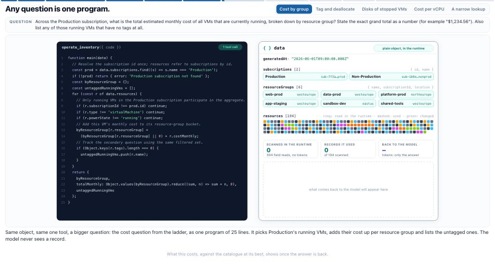

The same beat in reading mode and at the same window size, for comparison: the stage is 916 × 445, with the same proportions.

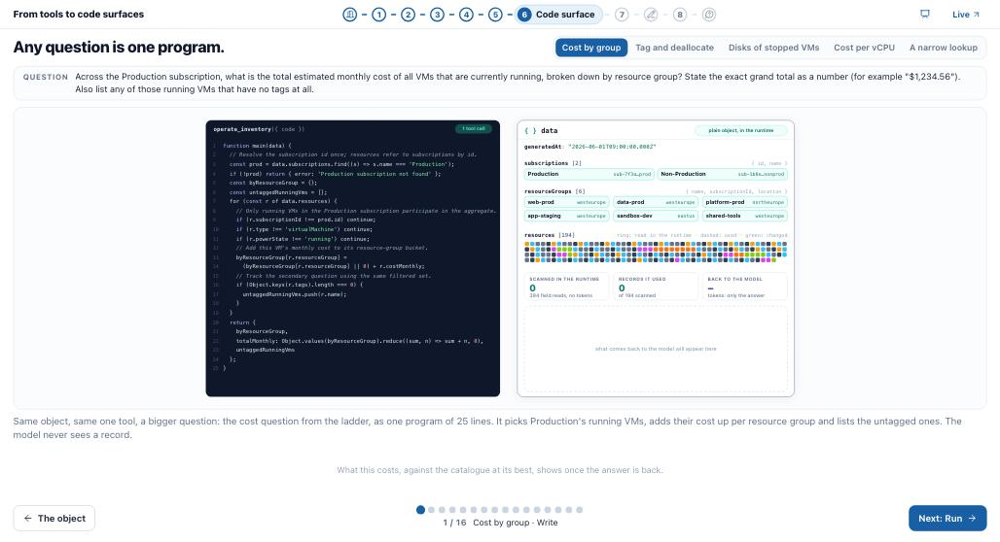

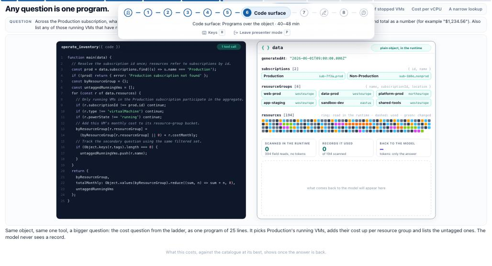

The keys are the tour's (see [tour-script.md](tour-script.md#keys)); these are the ones you use:

| Keys | Does |
|---|---|
| `→` `PageDown` `Space` | next beat; past the last beat of a screen, the first beat of the next |
| `←` `PageUp` | back; at the first beat, the last beat of the screen before |
| `⌥` `→` `⌥` `←` · `]` `[` | next or previous screen (`Alt` on Windows and Linux) |
| `Home` `End` | first or last beat of the screen |
| `H` | the list of keys, over the page |
| `⌘` `Enter` | run the program in the editor, on ⑦ (Try it) and on **Your turn** |
| `Esc` | leave the editor, so the arrows step again |

After a click, focus is let go of, so the next arrow belongs to the talk and not to the button you clicked.

## Keeping time

Check the clock at each boundary. If you are more than two minutes behind, make the cut for the block you are about to give (they are listed again at the end, in the order to make them); if you are early, add one of the extras there. Never cut the questions.

| At minute | You have just given | Behind by 2 or more: in the next block |
|---|---|---|
| 3 | Welcome | Estate: walk the four middle lenses in one breath |
| 8 | ① | Naive tools: drop the bigger questions (beat 7) |
| 19 | ② | Where it strains: say each fix in one sentence |
| 26 | ③ | A language: rungs 2 to 5 in one breath |
| 33 | ④ | The object: the three reshaping beats as one |
| 40 | ⑤ | Code surface: drop the cost-per-vCPU example |
| 48 | ⑥ | Security and writes: the first two gates as one, and skip Try it |
| 56 | ⑦ | Your turn: no variations after the results |
| 62 | **Your turn** | Results: keep the order, the newest model and the unplanned tasks as one |
| 68 | ⑧ | Wrap: beat 1 in one sentence, then straight on |

---

## Welcome · 0–3 min

**Ask.** In the chat: what do your agents work with today? A handful of narrow tools, one query tool, or code?
**Beats.** 3. **Pace.** Three minutes, about one a beat; no demo yet.
**Why it is here.** The room commits to something before anything is shown, and you learn which half of the talk to lean on: if most say narrow tools, ③ is theirs; if many say one query tool, spend longer on ④.

| # | Do · point at | Say | Hold |
|---|---|---|---|
| 1 | Open `/workshop`. Beat 1 is lit: *What you leave with*. Point at the three verbs. | "One design question for ninety minutes: how should an agent work with a large, structured estate? By the end you can do three things. Understand why a catalogue of narrow tools strains as the questions widen, and what each fix costs the model. Try: change a program that runs over the estate as plain data, and say what it will do before it runs. Judge: when a catalogue is enough, when a code surface earns its keep, and what to measure on your own estate." | 1:10 |
| 2 | `→`. *The ninety minutes*: the agenda, drawn to scale. Point at the orange block at the end. | "This is the plan, to scale. Seventy minutes of talk, twenty for questions: the orange block. Ten times I will stop and ask you for a guess in the chat; the first is in a minute. If we run late I cut the optional detours, never the questions." | 1:00 |
| 3 | `→`. *How we will work*. Then ask, and wait. | "Four rules. Predict in the chat before the screen answers. Ask whenever: I take questions at the pauses and in the last twenty minutes. No model runs live, so every number repeats. And follow along if you like: the repository is public. First guess: what do your agents work with today? A handful of narrow tools, one query tool, or code?" Wait 20 seconds; read two or three answers aloud and say which half of the talk they point at. | 0:50 |

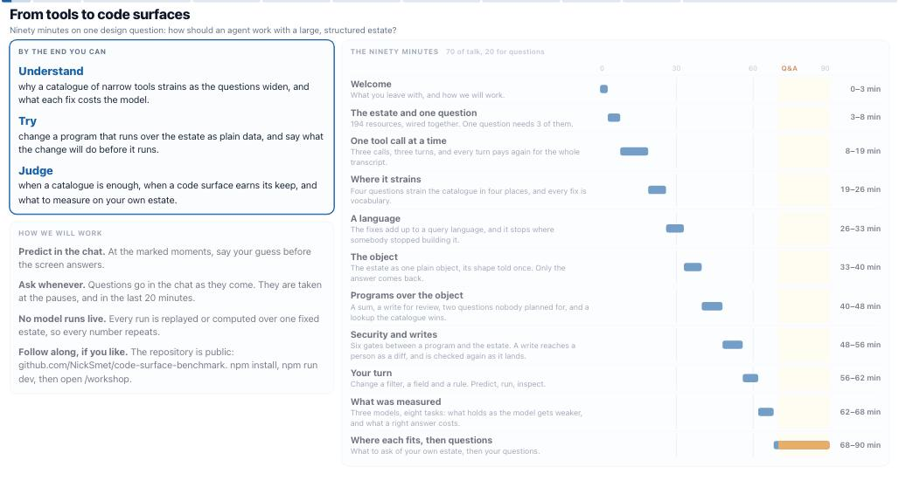

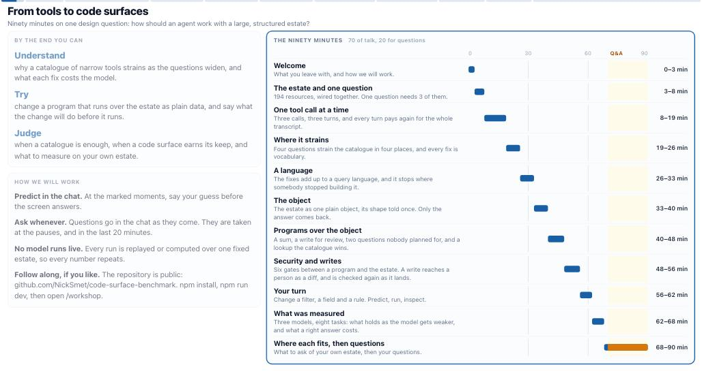

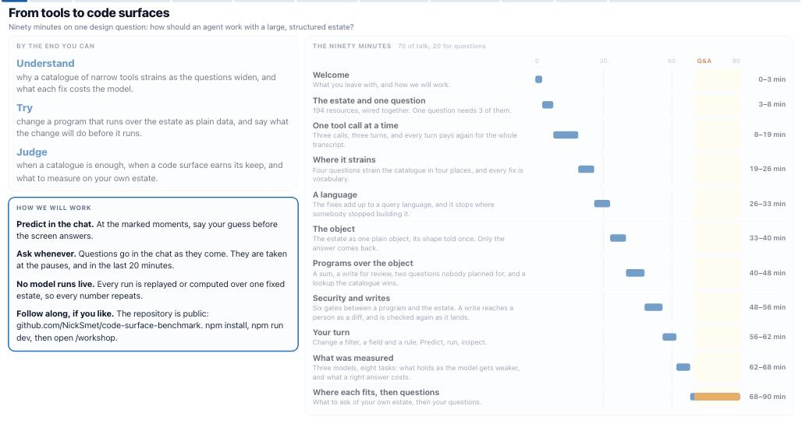

---

## ① The estate and one question · 3–8 min

**Ask.** How many of the 194 records does "power state and public IP of web-prod-03" need?
**Beats.** 6 lenses, then the question. **Pace.** Five minutes: one on the picture, under one on the cost of "put it all in the prompt", the rest on the question.
**Listen for.** Guesses from 1 to 194. The answer is 3. Anyone who says 1 has the right instinct and has missed that the VM does not hold its own IP.

Relationships to teach, and no others: a VM holds the id of its network interface, and the interface holds the id of its public IP. Everything else on the picture is context.

| # | Do · point at | Say | Hold |
|---|---|---|---|
| 1 | `→` from the welcome. Type lens. Point at the pod key: square is a VM, circle its NIC, small square its public IP (dashed when it has none), bars its disks. | "This is the estate the agent works on: 194 resources, 44 of them VMs, in six resource groups across two subscriptions, about fifteen thousand eight hundred dollars a month. One pod is one VM and what hangs off it. The circle is its network interface, the small square its public IP, the bars its disks. They point at each other by id: the VM holds the id of its NIC, and the NIC holds the id of its public IP. Remember that; it is the one relationship you need this morning." | 1:00 |
| 2 | `→`. Power lens. | "The same estate by power state. A question about power state reads one field on each VM." | 0:30 |
| 3 | `→`. Cost lens. | "By monthly cost. A question about money reads the cost and the group." | 0:30 |
| 4 | `→`. Idle lens. | "Idle: which VMs nobody has touched. This is the field the write question uses later." | 0:25 |
| 5 | `→`. Tags lens. | "Tags: which resources carry some and which carry none. That is the write question's other half." | 0:25 |
| 6 | `→`. *In context*: every pod one colour, "≈ 28.1k tokens". | "The sixth view is not a colouring. It is the estate as a model would be handed it, all of it, about twenty-eight thousand tokens at four characters a token. Hold that number: it is what 'just put it in the prompt' costs, and every turn of a conversation pays it again." | 0:45 |
| 7 | The ask. | "Now your guess. The question: power state and public IP of web-prod-03. How many of the 194 records does it need?" Wait 30 seconds; the co-host reads three guesses. | 0:35 |
| 8 | Click **Granular read** under *Ask a question*. | "Three: the VM, its NIC, its public IP. The heading says so, and the answer is fourteen tokens. Twenty-eight thousand in the haystack, three records in the needle, fourteen tokens of answer. How little of the estate has to travel to produce that answer is the whole design problem." | 0:40 |
| 9 | Click **Filter + aggregate**, **Bulk write**, **Single lookup**, five seconds each. | "Other questions need other amounts: 18 records for the aggregate, 37 for the bulk write, none for the lookup. Keep these four: we meet them all again." | 0:10 |

**If you are behind.** Say beats 2 to 5 in one breath ("power, cost, idle, tags: each question reads a different field", 0:40 for all four) and skip beat 9. Saves 1:20.

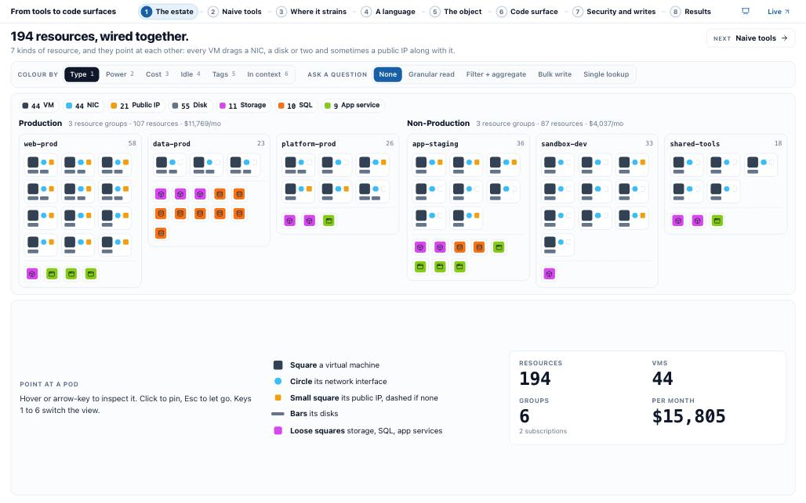

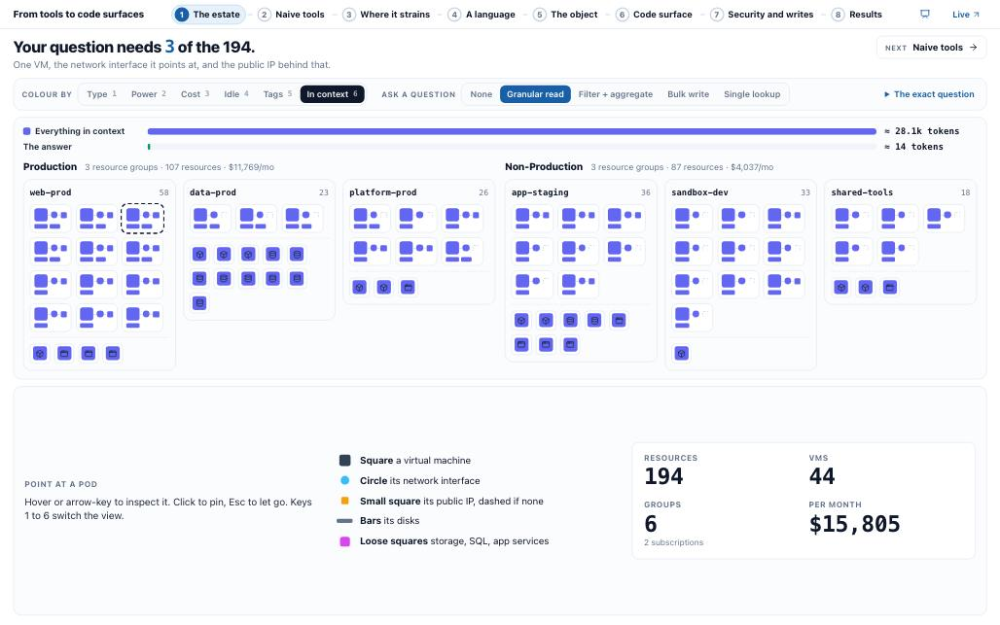

---

## ② One tool call at a time · 8–19 min

**Ask.** The answer is 14 tokens. Before the last turn: roughly how many tokens does the run bill?
**Beats.** 5, and the tabs on each. **Pace.** Eleven minutes, the longest block, because this is where the cost model is taught. Pause on every call: the bar under it is the lesson.
**Listen for.** Guesses from 14 to 100,000. The bill is about 5,900.

The model has six narrow tools. The replay is scripted (the model's choices) over real tool results, so it shows calls, turns and tokens and claims no failure rate.

| # | Do · point at | Say | Hold |
|---|---|---|---|
| 1 | `→`. The question beat. Click the **Setup** tab, then **You**. | "The question from the last screen, now as an agent runs it with an ordinary tool catalogue: list subscriptions, list resource groups, list resources, get one resource, update tags, set power state. Seven hundred and thirty-three tokens of tool definitions and 281 of instructions, sent before the model has read the question, and sent again on every turn. That is the fixed cost of having tools at all." | 1:20 |
| 2 | `→`. Turn 1: web-prod-03 lights as a full read. The **Turn 1** tab opens by itself: the raw call and the record it returned. Point at the first bar. | "Turn one: the model asks for the VM. It gets back the record, and in it, the id of its NIC. It could not have asked for the NIC in the same turn, because it did not know the id yet. That is a dependency, not a design flaw, and it is why the calls cannot be batched. Look at the bar: instructions and definitions, the question, the call and its result." | 1:50 |
| 3 | `→`. Turn 2: the NIC is read in full. Point at the second bar, then the first. | "Turn two, the NIC. Now look at what the model sends: everything from turn one again, plus the new call and its result. Input is 1,346 tokens against 1,050 a turn ago. Each turn pays for the instructions, the definitions, the question and every earlier result again. Prompt caching discounts the repeated prefix; it does not remove the new tokens, and it does not remove the round trip." | 1:20 |
| 4 | `→`. Turn 3: the public IP. | "Turn three, the public IP: input 1,584. What is growing is not the question and not the tools. It is the transcript. A longer chain makes this worse faster than it makes it longer: each added turn re-sends everything before it." | 1:20 |
| 5 | The ask. Do not press `→` yet. | "The next turn is the answer, fourteen tokens long. Before I show you the bill: roughly how many tokens does the whole run bill?" Wait 40 seconds; the co-host reads guesses. | 1:20 |
| 6 | `→`. The answer turn. Point at the tiles: *Billed so far*, *Billed + text*, *Setup share*. | "About 5,900: 5,801 in, 93 out. For fourteen tokens of answer. That is 3.6 times the text that matters, and 69 percent of the input is the same setup, every turn. The hatched part would be cached at a discount in real life. We count every token at full price to show the shape, not the invoice. Whoever guessed within a factor of two: that is a good instinct, and it is wrong in the direction everyone's is." | 1:50 |
| 7 | Optional. Click **Filter + aggregate**; flip **Route** between *Broad list* and *Verify each VM*; `End`. Click **Bulk write**; `End`. | "Same tools, bigger questions. The aggregate is one call or nineteen, depending on which route the model picks, because the catalogue allows both. The bulk write is thirty-eight calls, one write per resource. The next screen lines these up." | 2:00 |

**Say, if asked whether this is how a real model behaves.** The link above the chart ("How honest is this replay?") says what is scripted. The scripts add numbers exactly and never mis-copy, so how often a live model slips depends on the model; the measured runs are on ⑧.
**If you are behind.** Drop beat 7. Saves 2:00.

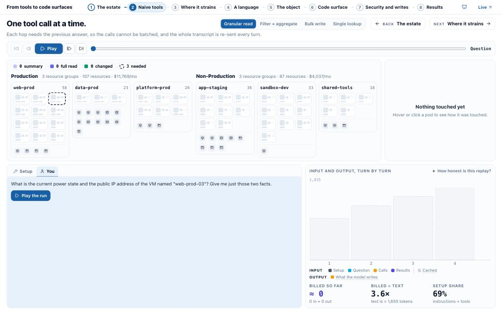

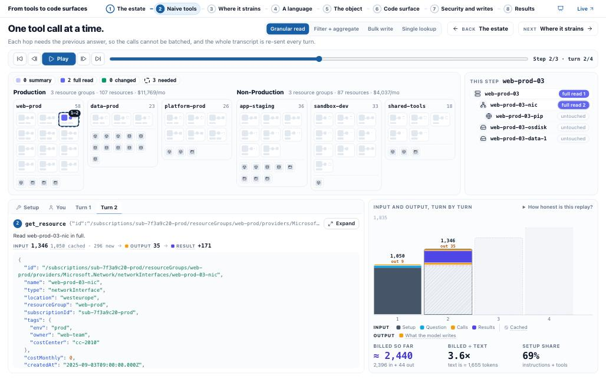

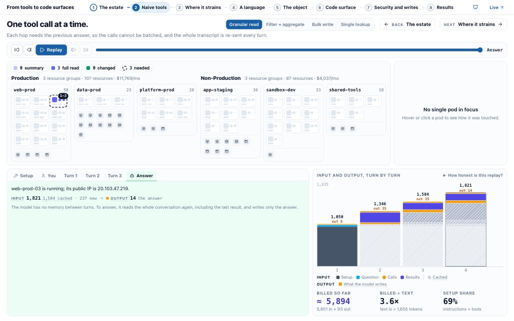

---

## ③ Where it strains · 19–26 min

**Ask.** For each problem, before the fix: what would you add to the tool?
**Beats.** 11: the overview, then a problem and a fix for each of the five rows; the fifth fix is the verdict. **Pace.** Seven minutes: the four problems are one beat of setup, one ask and one answer each. Ask at each problem; the first takes longest, the rest are a reflex.
**Listen for.** Join, calculator, filters, "an update that takes a filter". The room usually has the fixes; the point is the pattern.

The runs are scripted and kind to the tools: they show structural costs, not failure rates.

| # | Do · point at | Say | Hold |
|---|---|---|---|
| 1 | `→` from ②. Five rows, calls and bills: 3 calls ≈ 5.9k, 1 call ≈ 3.8k, 19 calls ≈ 11.7k, 38 calls ≈ 27.8k, 1 call ≈ 2.2k. | "The questions from the first screen on the same catalogue, each at its best: from about two thousand to twenty-eight thousand tokens. They do not strain it in the same place, and each has a usual fix. These are scripted and kind to the tools, so read them as structure, not failure rates." | 0:30 |
| 2 | `→`. Row 1 opens: a chain, three calls. Point at the highlighted ids. Ask. | "Problem one: a chain. The highlighted ids are text the model copies out of one result and into the next call. A slip there is silent. Before the usual fix: what would you add to the tool?" Wait 30 seconds. | 1:05 |
| 3 | `→`. The fix: *Follow references inside the tool*, one `query_resources` call with a join. | "A join. One call starts at the VM and crosses to its NIC and its public IP. One call, not three." | 0:30 |
| 4 | `→`. Row 2 opens: a broad list, and the model's own sum. Ask again, shorter. | "Problem two: one call lists 21 VMs, 18 running, and then the model adds up their costs itself, in its reply: $5,461.22, and no tool did that and nothing checks it. What would you add?" | 0:40 |
| 5 | `→`. The fix: a calculator. "36 figures copied by the model, out of the list and into 4 calls". | "A calculator. The sums come out exact, but the calculator cannot see the estate, so the model copies every figure into a call: five calls where there was one. Exact, not cheaper." | 0:45 |
| 6 | `→`. Row 3 opens: `list_resources`, then one `get_resource` per running VM. Ask. | "Problem three, the cautious route: list the VMs, then look each running one up. Nineteen calls. The catalogue allows both routes, so the bill follows whichever the model picks. What would you add?" | 0:35 |
| 7 | `→`. The fix: wider tools, then filters in the tool. The strip of five designs: 58, 22, 40, 22, 1 calls. | "Not one step but a ladder: fold the lookups into wider calls, then let the tool filter across VMs. The strip is not a straight line: 58, 22, 40, 22, 1. A parameter that picks which slice you want makes it worse before an array makes it better. The next screen climbs it." | 0:35 |
| 8 | `→`. Row 4 opens: a ten-thousand-token list, then one write per resource, "+ 35 more". Ask. | "Problem four, a bulk write. List 194 resources, about ten thousand tokens, then one write each: thirty-eight calls and about twenty-eight thousand tokens, and the model spells out every change itself. What would you add?" | 0:35 |
| 9 | `→`. The fix: an update with a filter. Two calls: matched 33 changed 33; matched 4 changed 4. | "An update that says which resources match and what to set. The same job in two calls." | 0:30 |
| 10 | `→`. Row 5: one narrow tool, 79 tokens back. | "And a narrow question strains nothing: one call, 79 tokens back. The tool does exactly what the question asks." | 0:25 |
| 11 | `→`. The green verdict, "Keep it as it is", and the line under the table: every fix is vocabulary. | "A narrow tool is the right design when the question is narrow. The strain starts when the questions widen. Now look at the fixes together: a join, a calculator, a filter, an update. Each is one more thing for the model to learn and one more definition sent on every turn. Add them one at a time and you grow a query language. One more fix people reach for: call the same narrow tools from a program, so the round trips move out of the model's turns. I measure that on the results screen, as 'from a program'. Hold the question until then." | 0:50 |

**If you are behind.** Say beats 3, 5, 7 and 9 in one sentence each (0:15 a beat instead of 2:20 in all). Saves 1:20.
**Extra, if you are ahead.** Click **See the calculator** at beat 5: the whole ladder on one screen at rung 6, then the pill *Back to where it strains* returns to the same beat with the same rows solved (0:45).

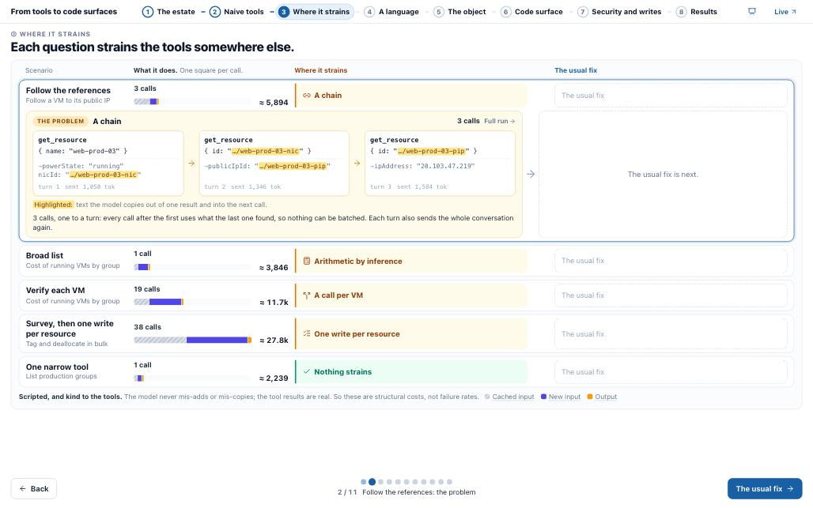

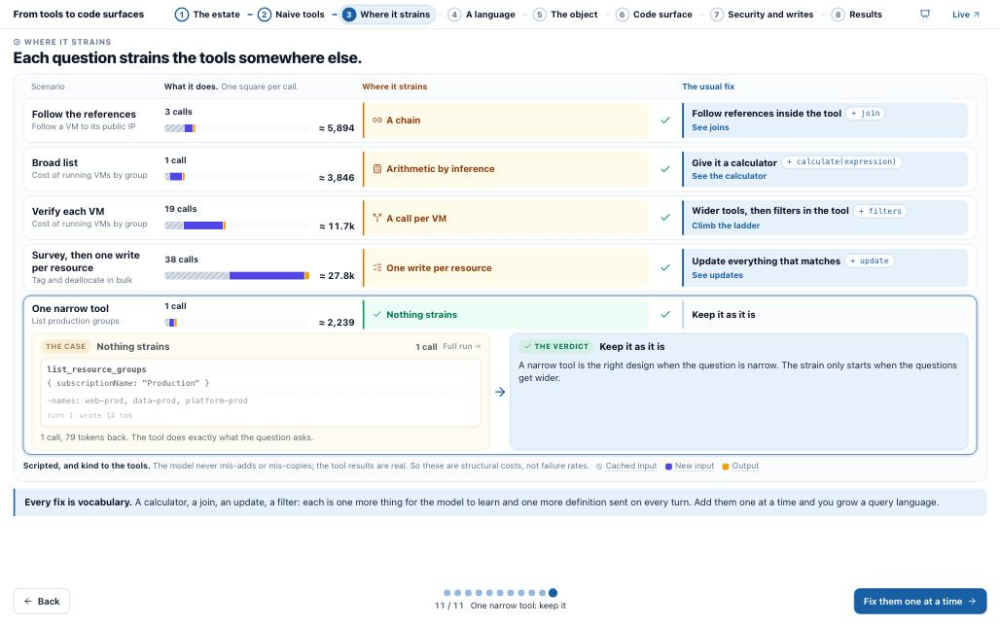

---

## ④ A language · 26–33 min

**Ask.** Four questions nobody planned for: how many does the language answer as first built?
**Beats.** 10: eight designs for one question, then the language, then its limits. **Pace.** Seven minutes: the ladder is a lot of rungs, so the middle ones go fast and the limits slow.
**Listen for.** Anything from 0 to 4. The answer is 0 of 4.

This is the screen to say "grammar" on. Every parameter added to a tool is a production in a grammar the model must learn from a description, and that description is sent on every turn.

| # | Do · point at | Say | Hold |
|---|---|---|---|
| 1 | `→` from ③. Rung 1. Point at the ladder: one row per design, with round-trip squares and the billed bar. | "One question, the cost question, put to eight tool designs. All eight reach the same answer. Design one is the obvious one: a tool per property. Fifty-eight calls, about eleven thousand tokens." | 0:40 |
| 2–5 | `→` four times, about thirty seconds each. Point at the yellow box under the ladder each time: what pushes you from this rung to the next. | "Rung two: every fact is its own round trip, so you consolidate: 22 calls. Rung three: a tool returns a few hundred tokens when you need a power state, so you add a parameter for the aspect you want. That is worse: 40 calls, about 9,200 tokens. Rung four: a slice still takes two calls for two aspects, so you make it an array: 22 calls, about 5,200. Rung five: it still visits one VM at a time, so you add filtering across VMs. One call, about 2,700 tokens." | 1:45 |
| 6 | `→`. Rung 6, the calculator: 5 calls, ≈ 5,450 against ≈ 2,688. | "The calculator from the last screen. Exact now, and not cheaper: five calls and about 5,450 tokens, against 2,688 for the plain list. It cannot see the estate, so the arithmetic has to move next to the data." | 0:35 |
| 7 | `→`. Rung 7, a query language: 2 calls, ≈ 2,138, the cheapest row. | "So the filter grows: grouping, aggregation, only some fields. You have built a query language. For this question it is the cheapest row on the page, 2,138 tokens, because it was built for this question." | 0:35 |
| 8 | `→`. *Grow the language*. Switch on **Follow references** and **Updates**. Point at: Definition ≈ 987 (+49% on the first design), Keywords to learn 32, Benchmark tasks 4 of 4. Optional: **Try a query**, **Run**. | "Here is the language we just built. Each feature answers one more question and makes the definition longer. With follow-references and updates on it takes all four of our benchmark tasks in about a thousand tokens of definition, 49 percent more than design one, and thirty-two keywords the model has to know." | 1:00 |
| 9 | `→`. *What it cannot answer*. Ask first, then reveal. Then click **Turn on "Follow references"**, and **Turn on "Computed values"**. | "Four questions nobody planned for. As first built, how many does the language answer?" Wait 30 seconds. "None. Each refusal names the feature it would need. Turn one on and that question works: one of four, sixteen rows back, the same as the code finds. Turn computed values on and the cost-per-vCPU question still fails: the feature only knows days-since. Every new kind of question is another feature. The same four questions as ordinary code just run: four of four." | 1:45 |
| 10 | `→`. Rung 8: 1 call, ≈ 3,468, schema ≈ 1,312. | "The eighth design is not another tool. It hands the model the objects, and the model writes the operation. On this question it is not the cheapest: the language was built for it. The case is breadth: the definition stays about 1,041 tokens whatever you ask, and filter, group, sort and divide are things the model already writes." | 0:40 |

**Say it straight.** The code tool's definition is longer than the six narrow tools' (1,041 tokens against 733). You pay it every turn; it does not grow with the questions. The language's grows with every feature.
**If you are behind.** Rungs 2 to 5 in one minute, and at beat 8 leave the switches alone: 0:40 for the beat. Saves 1:05.
**Extra, if you are ahead.** At beat 8, **Try a query** with a join on (1:00).

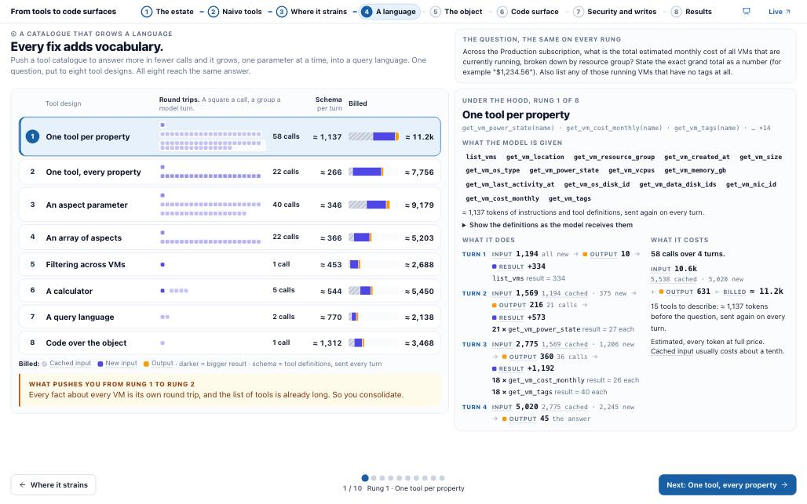

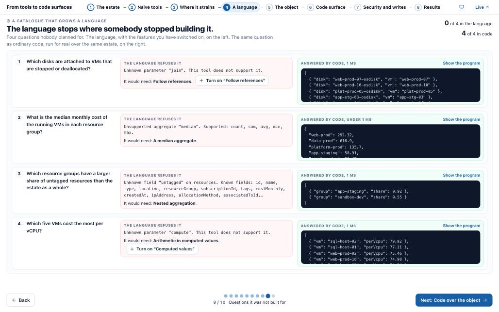

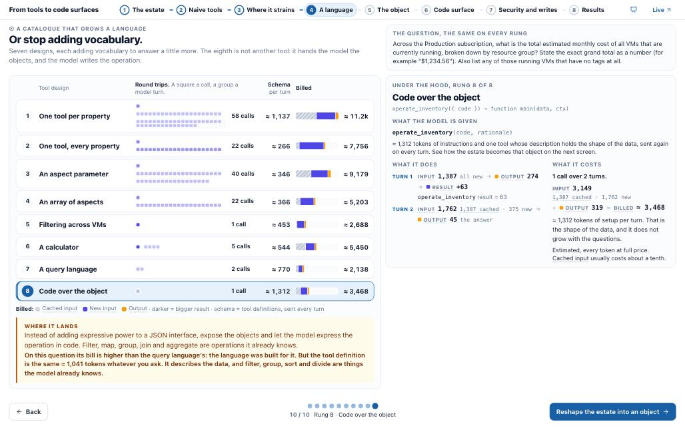

---

## ⑤ The object · 33–40 min

**Ask.** The program reads all 194 records. How many reach the model?
**Beats.** 11: reshape (4), describe (1), read (6). **Pace.** Seven minutes. Slow down here; if you must cut anywhere else, cut elsewhere.
**Listen for.** "All of them" is the common wrong answer. None of the records reach the model: only what the program returns.

This is the construction the whole talk has been heading to, so say it in the engineering vocabulary: a **projection** (a pure function from the stored records to a plain object), a **contract** (the shape, told once), and a **runtime** (runs the program where the data lives).

| # | Do · point at | Say | Hold |
|---|---|---|---|
| 1 | `→` from ④. Reshape. The estate map with web-prod-03 outlined and the empty `{ } data`: subscriptions [0], resourceGroups [0], resources [0]. | "Every fix so far added an interface for the model to learn. Change what it works on instead: turn all 194 resources into one plain object." | 0:30 |
| 2 | `→`. The two subscriptions and six groups slide into two short lists. | "Two subscriptions and six groups become two short lists. A group keeps the id of its subscription instead of sitting inside it. Nothing nests." | 0:25 |
| 3 | `→`. The lines from web-prod-03 to its NIC and from the NIC to its public IP. | "web-prod-03 does not contain its NIC. It holds the id of one, and the NIC holds the id of its public IP. What the estate draws as lines, the object stores as ids. That choice is the whole design: references by id mean any resource can be found with one lookup, and the model never has to follow a pointer through a tool." | 0:40 |
| 4 | `→`. 194 cells fill the resources list. The pods fade. | "Every resource becomes one record in one flat list, web-prod-03's pod included. The pods were only a drawing." | 0:30 |
| 5 | `→`. Describe. The dark panel, "tool definition, as sent to the model", "≈ 1,041 tokens in all". Under it, *Left out of the object*: `_internalId` and `_billingAccount`. | "The model is told this shape once, in the tool definition. It never receives the records; the runtime keeps them. And the fields we do not want it to see are not in the object at all. That is the difference between a projection and a deny-list: there is nothing to bypass. The rest of the definition, off screen, is the contract: define `function main(data, ctx)`; return any JSON-serialisable value to answer; mutate `data` in place to change something; only tags and a VM's `powerState` are writable; an edit outside that rejects the whole proposal. `ctx` has `now`, `daysSince` and `preview`. All of it is in `src/lib/surfaces/code/helpers.ts`." | 1:00 |
| 6 | `→`. Read. The reference program appears under `operate_inventory({ code })`, "1 tool call". | "To answer, the model writes a small program: one tool call, however many steps the question needs. This is the benchmark's own reference program for the question." | 0:35 |
| 7 | `→`. Lines 2 and 3 light. The counter *Scanned in the runtime*: 194. Then the ask. | "Line one indexes every record by id. It runs inside the runtime: a hundred and ninety-four records read, no model turn. So, the question: the program reads all 194 records. How many reach the model?" Wait 25 seconds. | 0:45 |
| 8 | `→`. The find line lights. A marker on one cell: "name read on 15 records, stopped at [14]". | "Find web-prod-03: it reads fifteen names and stops at resources[14]." | 0:30 |
| 9 | `→`. The NIC record lights. | "The VM holds its NIC's id, so the NIC is one lookup away: a key, not a search, and not another tool call." | 0:25 |
| 10 | `→`. The public IP record lights. | "The same again for the public IP, then read its address. Two lookups, no extra model turn." | 0:25 |
| 11 | `→`. Counters: Scanned 194, Records it used 3 of 194, Back to the model ≈ 40. The card shows `{"powerState":"running","publicIp":"20.103.47.219"}`. | "None of the records. Only the answer goes back: two values, about forty tokens. A hundred and ninety-four records read, three used, forty tokens back. The second screen spent about five thousand nine hundred tokens on the same question. The forty is the tool message the model reads; the fourteen from the first screen is its final reply. Different things, both true." | 1:15 |

**If you are behind.** Say beats 2 to 4 as one ("two short lists, ids instead of nesting, one flat list": 0:45 for the three). Saves 0:50.

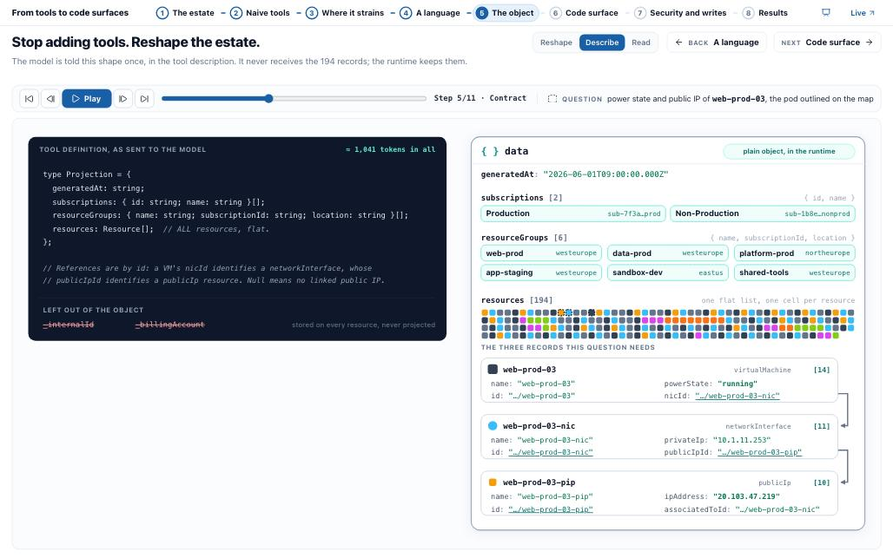

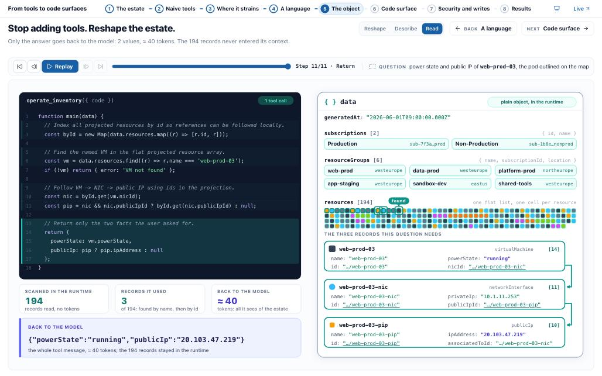

---

## ⑥ Programs over the object · 40–48 min

**Ask.** Before the narrow lookup: which is cheaper, the code surface or one narrow tool?
**Beats.** 16: five examples, each a Write, a Run and an Answer (the tag example has a fourth, Review). **Pace.** Eight minutes: a tie, a win, two questions nobody planned for, and a loss. What stands between a write and the estate is the next screen.
**Listen for.** "The narrow tool." The lookup costs 2,239 tokens as a narrow call and 3,032 on the code surface.

Keep the scoreboard honest, because the room can see it. Cost by group is a tie; the lookup is a loss; the tag question is the clear token win; what the code surface buys on the rest is breadth: no new feature, no calculator, no per-resource writes.

| # | Do · point at | Say | Hold |
|---|---|---|---|
| 1 | `→` from ⑤. Cost by group, Write. The question card, the 25-line program, the same `data` object on the right with empty counters. | "Same object, same one tool, a bigger question: the cost question from the ladder as one program. Pick Production's running VMs, add their cost up per resource group, list the untagged ones. Plain JavaScript: filter, accumulate, return. The model never sees a record." | 0:35 |
| 2 | `→`. Run. The program lights. Rings are reads, dashed are used. Scanned 194 (394 field reads, no tokens), Records it used 18 of 194. | "The runtime runs it where the data lives. A hundred and ninety-four records scanned, not one sent to the model. The eighteen that pass every filter are the ones it adds up." | 0:30 |
| 3 | `→`. Answer. ≈ 63 tokens. The strip: Catalogue best case 3,846, 1 call; Code surface 3,468, 1 call. | "Only the answer goes back: about sixty-three tokens. The program added the totals, so there is no sum for the model to get wrong. And the bill is about the catalogue's best case: one call that happens to carry what this question needs. Not a win here. The win is elsewhere." | 0:45 |
| 4 | `→`. Tag and deallocate, Write. The tool header now reads `operate_inventory({ code, rationale })`. | "The write question as a rule: tag what is untagged in app-staging, deallocate the VMs that sat idle. The model sends the rule and a one-line rationale, not a list of thirty-seven resources. It mutates `data` in place; it does not call a write tool." | 0:30 |
| 5 | `→`. Run. Scanned 194 (609 field reads), Proposed changes: 70 fields on 37 resources. | "It runs on a copy of the estate, and the runtime compares before and after: seventy field changes on thirty-seven resources, and nothing else moved. The change set is derived, not declared: the program cannot claim to have changed less than it did." | 0:25 |
| 6 | `→`. Answer. ≈ 97 tokens. | "The model is told just enough to write its summary, about ninety-seven tokens. The seventy-field change set stays in the runtime." | 0:25 |
| 7 | `→`. Review. Click **Approve and apply**, then **Undo**; or **Decline**. The card: `app-stg-01-pip + env=staging + owner=app-team`, `dev-box-02 powerState stopped → deallocated`, "37 resources, 70 fields · tags on 33 resources · power state on 4". | "Nothing is applied until a person reviews the change set. Approve and it lands in this copy of the estate. Decline and nothing changes. This is the artifact a reviewer works from: not the model's description of what it did, but what the runtime saw it do." | 0:40 |
| 8 | `→`. Disks of stopped VMs, Write. The eight-line program. | "A question the query language was not built for: which disks belong to stopped or deallocated VMs? It has to follow a reference. As code it is eight lines." | 0:25 |
| 9 | `→`. Run. 194 scanned (546 field reads), 32 records used. | "Same runtime, new question: a lookup by id for each disk's VM. Thirty-two records end up in the answer, the disks and their VMs." | 0:20 |
| 10 | `→`. Answer. ≈ 248 tokens. Three boxes: red, the language "Refused: Unknown parameter "join""; "What it would take: a new feature, Follow references"; green, "Answered with the one tool it already has". | "Sixteen disks come back, about 250 tokens. Nothing was added to the tool surface. The language from the last screen refuses it; code does not need a feature." | 0:35 |
| 11 | `→`. Cost per vCPU, Write. The short program: filter, map, sort, slice. | "Another one nobody planned for: which five VMs cost the most per vCPU? Dividing and sorting is what the model already writes fluently, so it needs no calculator tool either." | 0:15 |
| 12 | `→`. Run. 194 scanned, 5 records used. | "The program divides cost by vCPUs for every VM and sorts. Five VMs reach the model." | 0:15 |
| 13 | `→`. Answer. ≈ 79 tokens. | "Five rows, about seventy-nine tokens. The program did the dividing, so there is no arithmetic for the model to get wrong." | 0:25 |
| 14 | `→`. A narrow lookup, Write. The ten-line program. Ask. | "A narrow question: how many resource groups does Production have, and what are they called? Ten lines, and not one resource record involved. Before I run it: which is cheaper, the code surface, or one narrow tool?" Wait 30 seconds. | 0:55 |
| 15 | `→`. Run. "6 groups" read, "3 of 6" used. | "It reads six resource groups and no resource record. Three are Production's." | 0:15 |
| 16 | `→`. Answer. ≈ 42 tokens. The strip: Catalogue best case 2,239, 1 call; Code surface 3,032, 1 call. "Here the catalogue wins." | "Three names, forty-two tokens. The narrow tool is cheaper here: 2,239 against 3,032, so the code surface is billed 1.4 times as much, because it has to describe the whole object first. I would rather show you where it does not win." | 0:45 |

**Bridge.** End on the loss, then ask it aloud: "Every write on this screen ended at a person. What stands between a program and the estate, before that person looks, and after?" That is the next screen.
**If you are behind.** Drop the cost-per-vCPU example (beats 11 to 13). Saves 0:55.

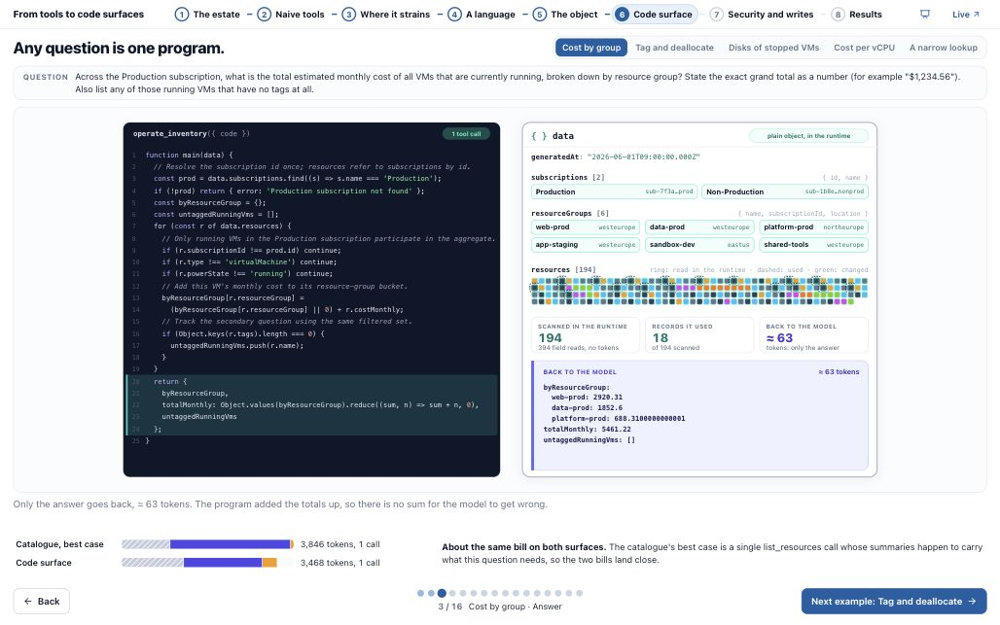

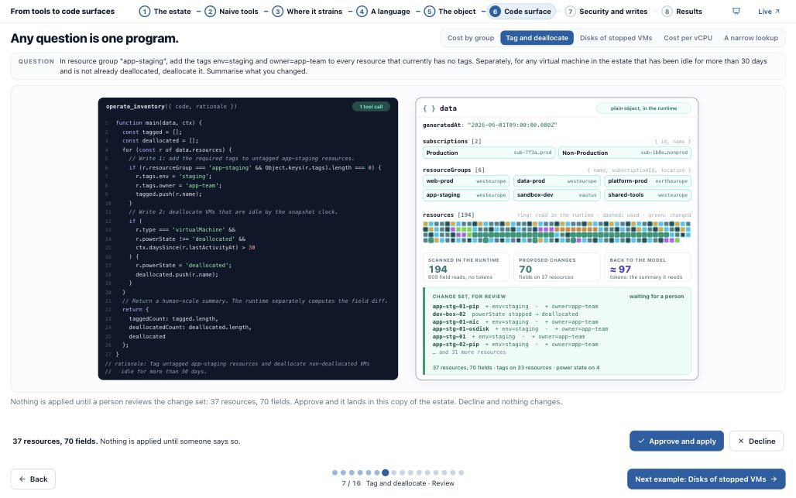

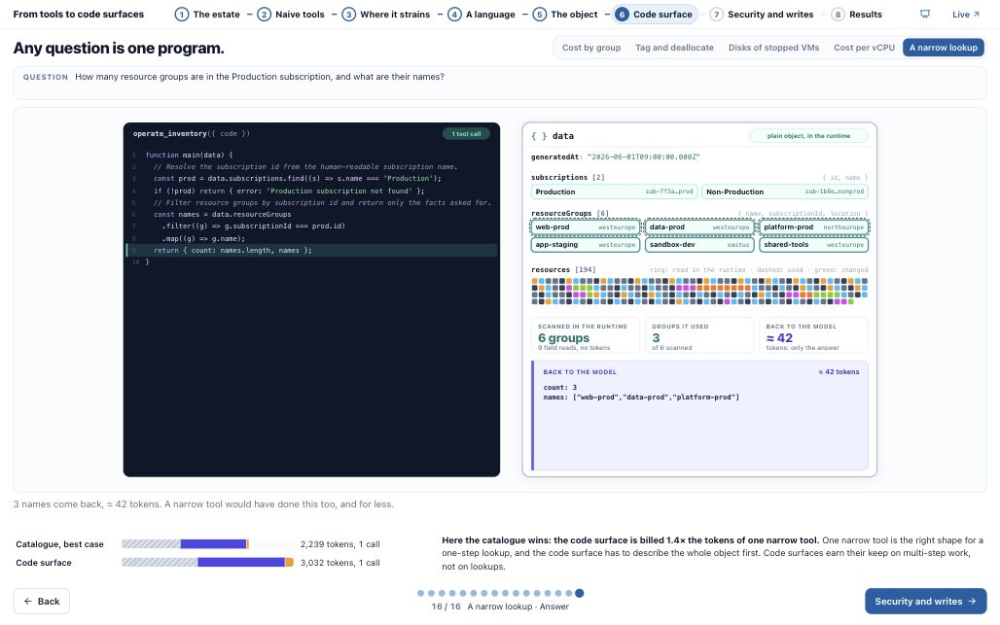

---

## ⑦ Security and writes · 48–56 min

**Ask.** The model asks to stop the three most expensive running VMs. Your rule: "No power-state change in Production without a person." How many of the three does it refuse?
**Beats.** 7: the six gates in the order a program meets them (Read, Run, Change, Rule, Review, Apply), then Try it. **Pace.** Eight minutes: about a minute a gate, the ask before the rule, and the last minute for the room's own program.
**Listen for.** Guesses from 0 to 3. The answer is 3 of 3: the three most expensive running VMs are all SQL hosts in Production.

This screen answers what the review on ⑥ leaves open: what stands between a program and the estate, before a person looks and after? Keep three things apart out loud. The projection, the change contract and the apply check are the benchmark's own, and every program on the screen is really run through them. The Production rule, the model's retry and the estate moving on under the change set are written for the tour. And none of it is a security boundary: the contract catches ordinary programs, not hostile code.

| # | Do · point at | Say | Hold |
|---|---|---|---|
| 1 | `→` from ⑥. Read. The billing account is loaded. Point at the strip of gates over the stage: Read is the current one. Line 5 is flagged "not in the projection"; the answer shows `name` and nothing else (≈ 31 tokens). Optional: **Read internal fields**. | "Same stage, six gates over it. The first is what exists. The estate holds a billing account for this VM, and the projection was built without it, so the program reads nothing: no error to catch, and nothing to leak. A deny-list can be got around; a field that is not in the object cannot be read." | 1:05 |
| 2 | `→`. Run. Line 3 is flagged "no network"; the red box: `error: fetch is not a function` (≈ 24 tokens). Optional: **Loop forever**: "Stopped after 1500 ms." | "The second gate is what may run. A program gets a short list of globals and no network, so the call fails on the line that makes it, and the model reads why. A loop that never returns is stopped by a clock. I will say it before you do: this sandbox is a demo, a worker and a time limit. It is not a security boundary." | 1:00 |
| 3 | `→`. Change. Line 3 green ("allowed, dropped with the rest"), line 4 red ("read-only"). The red box (≈ 27 tokens): `error: web-prod-03: costMonthly is read-only`. Optional: **Tag with a number**, **Invent a field**, **Delete a resource**. | "The third gate is what may change: tags, string to string, and a VM's power state. Everything else is read-only. One bad edit rejects the whole proposal, so the valid tag change was dropped with it, and the model is told which field. The change set is derived by diffing before and after, so a program cannot claim to have changed less than it did." | 1:05 |
| Ask | Do not press `→` yet. | "The model has been asked to cut the bill, and it proposes to stop the three most expensive running VMs. You have one rule of your own: no power-state change in Production without a person. How many of the three does the rule refuse?" Wait 40 seconds; the co-host reads three guesses. | 0:45 |
| 4 | `→`. Rule. Line 8 is flagged "3 of 3 refused by your rule"; three VMs are ringed in the strip. The red box (≈ 57 tokens): `error: production-power: 3 of 3 changes set a power state in Production (sql-host-01, sql-host-02, sql-host-03). A person has to make those. Nothing was applied.` Click **Rule off**, then **Rule on**. | "All three. The program is valid and the contract lets it through; the rule stops it, because it reads what the program would change and not how the program is written, so it holds for any program, including one nobody has written yet. The refusal names the VMs, so the model can narrow. Switch the rule off and the same program goes to a person: nothing but a person's eye between the model and those three VMs. One caveat for the room: this rule is ours, written for the tour. The benchmark's runtime has no such rule." | 1:05 |
| 5 | `→`. Review. The model has read the refusal and narrowed its program to outside Production. Line 10 is flagged "goes to review"; the change set: ci-runner-02, ci-runner-04, ci-runner-05, `powerState running → deallocated`, "3 resources, 3 fields". Optional: **Decline**, then **Undo**. | "The model read the refusal and tried again, outside Production. Every gate before the person is green, and the change set reaches them as a diff: three resources, three fields, from what the runtime saw and not from what the model says it did. Nothing is applied until someone says so. Decline, and the model is told not to retry this change set." | 1:00 |
| 6 | `→`. Apply. Click **Approve and apply**. The second row says "already deallocated", and the card says "approved, then refused: not applied": `error: "Stale or invalid power-state change"  status: "not_applied"`. | "Approval is not the end. Applying checks the proposal against the estate as it is now. While it waited, someone else deallocated ci-runner-04, so nothing is written, and the model is told why; it can read again and propose again. A review is a snapshot, and the estate is not." | 1:10 |
| 7 | `→`. Try it. Click a program, or click in the editor, change a line and press `⌘` `Enter`. The gate that stops a program is red. | "Anything a program might try. Give me one in the chat: a field to read, a call to make, a change to a VM. We run it and the gates decide." Run one or two, and read out where each stopped. | 0:50 |

**Never call the sandbox safe.** The screen says it is not a security boundary, and the README's "Execution and isolation" section says what a production boundary needs: an isolated process, container or microVM, credentials kept outside it, and a change set validated by something other than the code that produced it.
**If you are behind.** Say the first two gates as one ("what exists, what runs": 0:45 for both) and skip Try it. Saves 2:10.
**Extra, if you are ahead.** Take a second program from the chat at Try it (1:00).

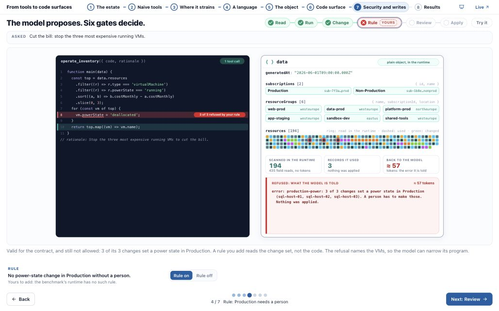

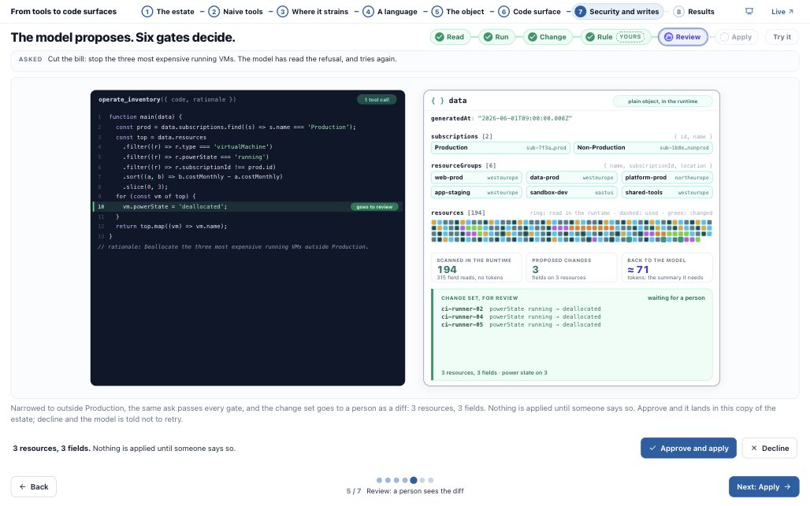

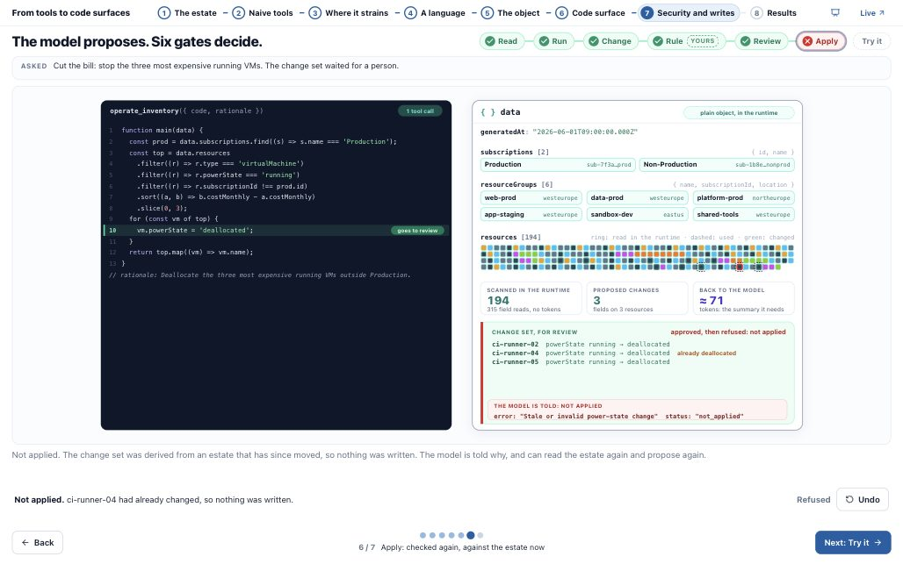

---

## Your turn · 56–62 min

**Ask.** Each exercise asks its own prediction.
**Beats.** 6: three exercises, each a Predict and a Result. **Pace.** Six minutes, two each: predict 1:00, result 0:30, one variation 0:30. The room predicts in the chat; you run it. A volunteer can dictate an edit, and you type it.
**Why it is here.** This is the "try" outcome. It is the only place the room changes a program, so do not trade it for time elsewhere.

Each exercise starts from a program the room has already seen on ⑥, changed in one place. The number tiles under the stage show the base figure and, after the run, the new one. The chips (**Before**, then each change) load a program and run it; the editor takes anything else, and a program that is not one of the screen's own is run in the worker, with the 1,500 ms limit. After you run a program of your own, the screen says whether it gave the reference answer.

| # | Do · point at | Say | Hold |
|---|---|---|---|
| 1 | `→` from ⑦. **A filter**, Predict. The ask: "The cost of Production's running VMs, by resource group. Now only the ones in West Europe." Tiles read `3 → ?`, `$5,461.22 → ?`, `194 → ?`, `≈ 63 → ?`. | "Same program as the cost question. Add one condition: only the VMs in West Europe. Your guess in the chat: which resource group drops out, and where does the total land?" Wait 30 seconds; read two guesses. Point at the line where the condition would go. | 1:00 |
| 2 | `→`. Result. The program has one new line; the tiles fill. | "platform-prod drops out, because it is in North Europe, and the total goes from $5,461.22 to $4,772.91. Two groups, not three. And the runtime still scans all 194 records: a filter changes what is kept, not what is read. Reading is free." | 0:30 |
| 2b | Click the chip **Stopped, not running**, or type a change. | "Same edit another way: stopped instead of running. data-prod drops out and the total is $728.43. One line moved; the answer did not change shape." | 0:30 |
| 3 | `→`. **A field**, Predict. The ask: "The five VMs that cost the most per vCPU. Now also return each one's size and resource group." | "The cost-per-vCPU program. Now also return each VM's size and resource group. Your guess: will it read more records? And how much more will the answer cost the model?" Wait 30 seconds. | 1:00 |
| 4 | `→`. Result. Tiles: fields per VM 2 → 4, back to the model ≈ 79 → ≈ 145, records scanned 194 → 194, field reads 326 → 414. | "No more records: 194, as before. Eighty-eight more field reads, and they cost the model nothing. The answer goes from about 79 to about 145 tokens, 1.8 times. Reading is free; what the program returns is the bill." | 0:30 |
| 4b | Click **Return the whole record**. | "The lazy version: return the whole record. Nineteen fields a VM, about 1,237 tokens, almost sixteen times the bill, for the same question. This is the join without a program: everything comes back because nothing was chosen." | 0:30 |
| 5 | `→`. **A rule**, Predict. The ask: "Tag the untagged resources in app-staging, deallocate the idle VMs. Now tag only the virtual machines." Tiles read `70 → ?`, `37 → ?`. | "The tag-and-deallocate rule. Restrict the tagging to virtual machines. Your guess: how many field changes will the change set hold, and on how many resources?" Wait 30 seconds. | 1:00 |
| 6 | `→`. Result. The change set card, "waiting for a person". Tiles: fields changed 70 → 18, resources affected 37 → 11, back to the model ≈ 97 → ≈ 96. | "From seventy field changes on thirty-seven resources to eighteen on eleven: tags on seven VMs, power state on four. The runtime derived that from what the program did to the copy, and the model is told only about ninety-six tokens of it. The change set stays in the runtime, where a person can review it." | 0:30 |
| 6b | Click **Idle for 90 days, not 30**, then **The env tag only**. | "Thirty days to ninety: two fewer deallocations, 68 fields on 35 resources. Only the `env` tag: 37 fields on the same 37 resources. A rule is a few characters; the change set tells you exactly what it did." | 0:30 |

**Prompting a quiet room.** Ask for a number before you say anything: "closer to two or to ten?" A wrong guess is a better start than silence.
**If you are behind.** Skip rows 2b, 4b and 6b. Saves 1:30.
**Extra, if you are ahead.** Take a change from the chat and type it into the program live; the screen says whether it matches the reference answer.

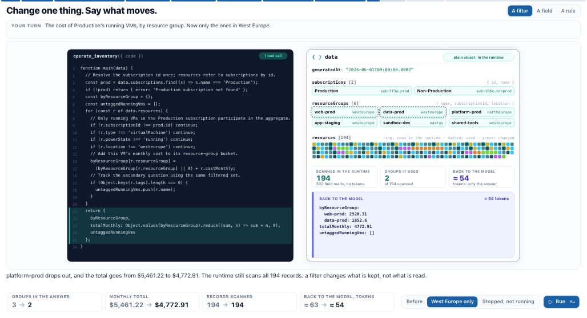

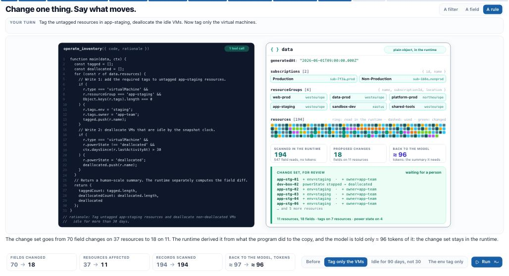

---

## ⑧ What was measured · 62–68 min

**Ask.** On the older model the code surface gets 40 of 40. Of the other five methods, how many of 40 does the best one get?
**Beats.** 6: three models in turn, then the questions nobody planned for, what a right answer costs, and why. **Pace.** Six minutes: the older model first, the middle one slower because it is the awkward one, three quick beats, and a reading.
**Listen for.** Guesses from 10 to 40. The best of the other five gets 30 of 40, and two of them do.

This is the only screen with measurements. Say them in that order: measured first (beats 1 to 5), the reason second and labelled as a reading (beat 6). The beats are an argument in the order of the models: the older one, where only the code surface reaches the top; the middle one, where it is not the cheapest; the newest, where price decides.

| # | Do · point at | Say | Hold |
|---|---|---|---|
| Ask | Do not press `→` from **Your turn** yet. | "The next screen is measured. On an older, smaller model the code surface gets forty of forty on the four preset tasks. Of the other five methods, how many of forty does the best one get?" Wait 30 seconds; the co-host reads three guesses. | 0:40 |
| 1 | `→` from **Your turn**. gpt-5.4-mini. The chart: right answers (the axis starts at 20%) against estimated dollars per 1,000 runs, on a log scale, left is cheaper. The code surface alone at the top, ringed. The table: Catalogue 21, 29 and 30; Tuned 30 and 22; hosted programs "not run" (this model has none); Code surface 40 of 40, $2.57. | "Higher is more right answers, further left is cheaper. Only the code surface reaches the top: forty of forty. The other five get between 21 and 30; the best is 30, and two of them get it. The 'from a program' rows are programmatic tool calling, the fix I mentioned and parked: 30 and 22. And the code surface is not the dear one: $2.57 per thousand runs, against $2.55 for the cheapest method, which gets 30." | 0:50 |
| 2 | `→`. gpt-5.6-luna. The markers glide left and up, with dotted lines back to where they were. A tuned-catalogue marker sits left of the code surface ($0.729 against $0.777) at 39 of 40; the hosted-program rings appear. | "A newer model, and a strange generation. It costs 3.75 times less per token, so everything slides left, and it does the work better, so everything slides up. The code surface is still at forty of forty, but it is not the cheapest here: the tuned catalogue, called one call at a time, is six percent under it and gets 39. In absolute terms the code surface costs a little more on this model than the best catalogue method, and it gets there with one tool and no tuning to the questions. I would rather show you that than skip it." | 1:00 |
| 3 | `→`. gpt-6-luna. Five markers at 100%; the code surface furthest left, $0.278. | "The newest: seven and a half to nine times less per token than the first. Five methods now get forty of forty, so accuracy no longer separates them and price decides. The code surface is the cheapest again: 28 cents per thousand runs against 34 for the next, which is 21 percent more." | 0:40 |
| 4 | `→`. Unplanned tasks. The same model, four tasks written after the tool sets were frozen. The tuned catalogue called one by one: $0.337 → $1.37 (4.05×). The code surface: $0.278 → $0.293. | "Same model, four questions nobody could have tuned a tool for, because they were written after the tool sets were frozen. The best catalogue method moves from 34 cents to a dollar thirty-seven per thousand runs: four times. The code surface moves from 28 to 29 cents and still gets forty of forty. Programs over the catalogue hold their cost too; what gets dear is calling tools one at a time." | 0:50 |
| 5 | `→`. What a right answer costs. Three bars on a log scale: $18.7, $1.40 and $0.286 per 1,000 right answers, with 13.3× and 4.90× between them; the tiles read 13.3× × 4.90× = 65.4×. | "Over all eight tasks, failures included, what a right answer costs. A newer model makes it thirteen times cheaper. The code surface instead of one-by-one calls, on that model, makes it nearly five times cheaper again. They multiply: sixty-five times between the older model with one-by-one calls and the newest with the code surface, eighteen dollars seventy against twenty-nine cents per thousand right answers." | 0:40 |
| 6 | `→`. Why. Left: *Why the code surface holds*, each line tagged Reading or Measured. Right: *What this does not show*. | "Why? That part is a reading, not a measurement: models write code fluently, and the object is documented by design, with the shape of the data and which record points at which. A program over the catalogue cannot look at a result before it runs, so a wrong guess about its shape becomes a confident wrong answer. And one thing we did measure: code alone did not hold. On the older model, programs over the catalogue got 56 of 80, and over the tuned catalogue 49. On the right is what this does not show. On the newest model accuracy ties, so there it saves money, not mistakes. On the two newer models, programs over the plain catalogue cost within 18 percent of the code surface on the unplanned tasks. It is one mock estate of 194 resources. A single narrow lookup is the one place a direct call wins, at about 0.6 times the tokens. And the dollars are estimates from the tokens the provider reported, not an invoice." | 1:20 |

**Do not say** that the code surface is more accurate on the newest model (it ties), or that code in general holds (on the older model, programs over the catalogue did not).
**If you are behind.** Say beats 3 and 4 as one (the newest model, then the unplanned tasks: 0:40 for both). Saves 0:50.

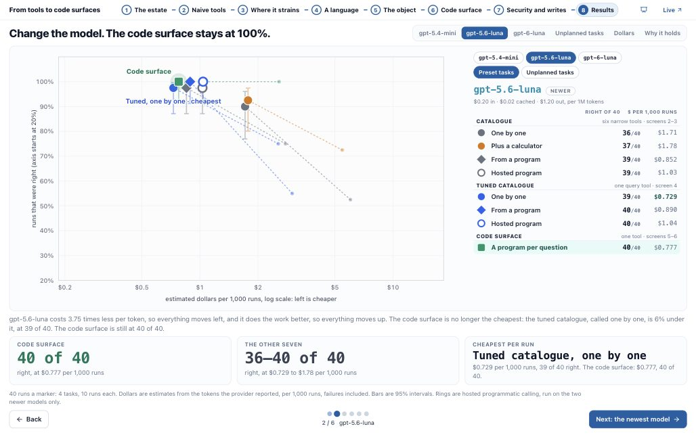

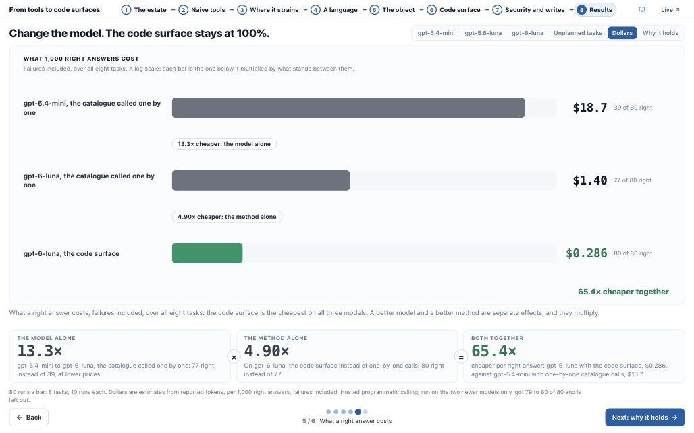

---

## Where each fits, then questions · 68–90 min

**Beats.** 3, then twenty minutes of questions. **Pace.** Two minutes of talk and the rest the room's.
**What it does.** Beat 1 restates the six lines of the talk, each read off the screen it points back to. Beat 2 turns the talk into six questions to ask of an estate that is not this one. Beat 3 is the repository and the questions; leave it up for the twenty minutes.

| # | Do · point at | Say | Hold |
|---|---|---|---|
| 1 | `→` from ⑧. *What we saw*: six lines, each with the screens it points to. | "Six lines. One question took three narrow calls and about 5,900 tokens for a fourteen-token answer. Every fix was vocabulary; together they are a query language that refused all four questions nobody planned for. The code surface is one tool and a program per question: about 63 tokens come back for the cost question. A program reads only the projection, and a write is a change set that a rule of yours can read, a person sees as a diff, and a check repeats as it lands. And 80 of 80 on all three models; on the older one the others got 39 to 56." | 0:40 |
| 2 | `→`. *Ask of your own estate*: six questions, each with the screens it comes from. | "What to ask of your own estate, in the order I would. How wide are your questions? What does the model carry from call to call? What can a program see? What can it change, and who approves? Where does the code run, and not in this demo's executor. And what did you measure, on your model? The weaker the model, the wider the gap; run your own questions before you decide." | 0:50 |
| 3 | `→`. *Take it with you* and *Questions*. Leave it up. | "The repository is public: `npm install`, `npm run dev`, then open `/workshop`. This script and the programs you ran are in it. Questions, in the chat or unmuted. If you want somewhere to start: what would you measure first on your own estate?" | 0:30 |
| Q | Twenty minutes. | See below. | 20:00 |

**If you are behind.** Say beat 1 in one sentence and go on. Saves 0:30.

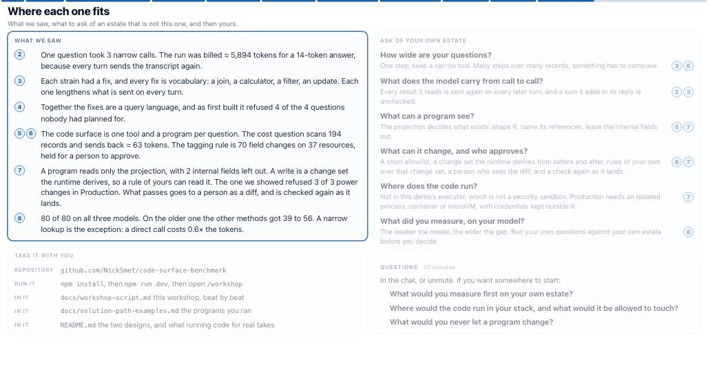

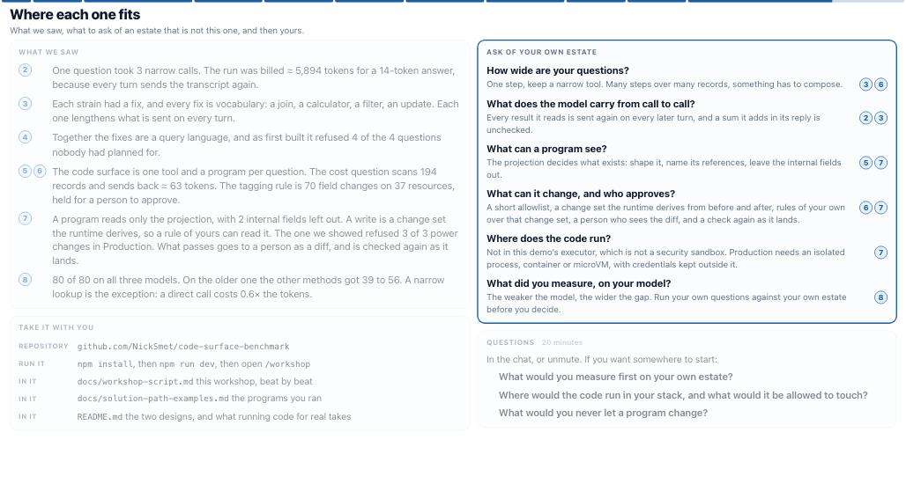

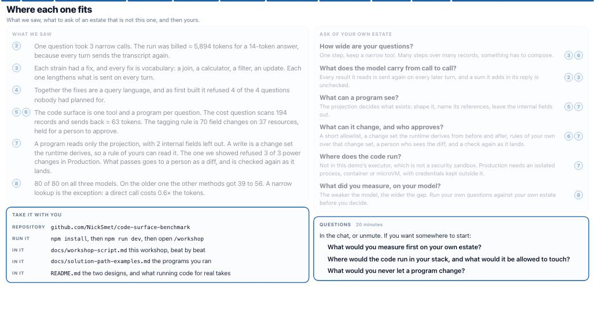

### The twenty minutes

- **Minute 70.** Beat 3 stays up. Read the first question aloud. If the chat is quiet after 20 seconds, ask the second.
- **Quiet room.** Three questions are on the screen for exactly this: what would you measure first on your own estate; where would the code run in your stack, and what would it be allowed to touch; what would you never let a program change.
- **Answer with the screen.** Jump with `⌥` `←` or the URL, answer, and come back with `]`. The jumps below are the ones the questions need.
- **Minute 85.** "Five minutes left; last questions." **Minute 89.** Say where the repository is, and stop.

| If the question is about | Jump to |
|---|---|
| what the model sees, and what it never sees | `/tour/object?step=4` |
| what a turn costs, and caching | `/tour/tools?step=4` |
| why not just a good query language | `/tour/language?stage=limits` |
| writes, review and approval | `/tour/code?ex=tag&step=3` |
| whether the sandbox is safe, and what stops a program | `/tour/guard?at=1` |
| where a rule of your own would go | `/tour/guard?at=3` |
| what happens to a change set that waited | `/tour/guard?at=5` |
| programmatic tool calling | `/tour/results?show=newer` |
| what it costs on a question nobody planned for | `/tour/results?show=unplanned` |
| how to decide for your own system | `/tour/wrap?at=1` |

---

## Questions you will get

**Isn't this just programmatic tool calling?** The "from a program" rows on ⑧ are exactly that: programs over the catalogue's tools. On the two newer models they do well (76 to 80 of 80) and cost between a quarter and a half of calling the same tools one by one. On the older model they fall to 56, and to 49 over the tuned catalogue, while the code surface stays at 80. The reading is that the object tells the model what the data looks like, and the catalogue gives it nothing to read. Hosted programmatic calling was run on the two newer models only (79 to 80 of 80) and is off the chart.

**Is the sandbox safe?** No claim is made. ⑦ says "This sandbox is a demo, a worker and a time limit, not a security boundary." In the tour, a program runs in a Web Worker with a 1,500 ms limit; in the benchmark, in `node:vm`. Production needs an isolated process, container or microVM, credentials kept outside it, and a change set validated independently of the code that produced it. What the demo shows is the contract: what the model can see (the projection), what it can change (an allowlist and a change set for review) and what it can run (a time limit).

**What about writes?** ⑥ and ⑦. On ⑥, the tag example: the program mutates a copy, the runtime derives the change set by diffing before and after, and a person approves. On ⑦, what else stands in the way: a contract on what can change, a rule of yours, and a check against the estate as it is when the change lands. The change set is not an atomic transaction across services: ordering, retries and partial failures are real integration work, and a restart cannot be represented by a net state diff. Approve and Decline act on the tour's copy only. The Production rule is the tour's own; the benchmark's runtime has no such rule.

**Where would my own rules go?** On the change set, not on the code. The rule on ⑦ reads what the program would change (which resource, which field, from what to what), so it holds for any program, including one nobody has written. In the tour it is one function over the change set; the benchmark's runtime has no hook for it.

**Does it scale to a bigger estate?** Not measured. One mock estate, 194 resources. The runtime reads records without spending model tokens, but the shape of the data still has to fit in the tool definition.

**If the query language is cheapest on the cost question, why not use it?** On that question it is the cheapest (2,138 against 3,468). It loses on breadth: 0 of 4 on the questions nobody planned for, and every feature that fixes one question lengthens the definition for all of them (+49% with join and update on).

**Why is the code tool's definition bigger than six narrow tools'?** 1,041 tokens against 733, because it describes the data. It stays the same whatever you ask. The language's grows with every feature.

**Which models, and which provider?** Three Azure OpenAI deployments: gpt-6-luna, gpt-5.6-luna and gpt-5.4-mini. Eighty runs a cell, eight tasks, ten repetitions. Dollars are estimates from the tokens the provider reported, not an invoice.

**Can we run it ourselves?** The tour and this workshop need no key and call no model: `npm install`, `npm run dev`, open `/workshop`. The live benchmark on the home page needs a provider key in `.env` (see the README); nothing in the workshop uses it.

**What did the model get to see in the code condition?** The question and a tool definition of about 1,041 tokens that describes the object. Never the records.

## If the clock says otherwise

Cuts, in the order to make them, with the minutes each saves. Together they are 12:30.

| Block | Cut | Saves |
|---|---|---|
| ⑦ Security and writes | The first two gates as one; skip Try it | 2:10 |
| ② Naive tools | Drop beat 7, the bigger questions | 2:00 |
| **Your turn** | Skip the variations: rows 2b, 4b, 6b | 1:30 |
| ① The estate | Beats 2 to 5 in one breath; skip beat 9 | 1:20 |
| ③ Where it strains | Each fix in one sentence: beats 3, 5, 7, 9 | 1:20 |
| ④ A language | Rungs 2 to 5 in one minute; leave the switches alone at beat 8 | 1:05 |
| ⑥ Code surface | Drop the cost-per-vCPU example, beats 11 to 13 | 0:55 |
| ⑤ The object | Beats 2 to 4 as one | 0:50 |
| ⑧ Results | Beats 3 and 4 as one | 0:50 |
| Wrap | Beat 1 in one sentence | 0:30 |

Extras for a room that is early or lively: the calculator detour on ③ (0:45), a query with a join on ④ (1:00), a second program from the chat on ⑦ (1:00), a change dictated by the room on **Your turn** (0:45 each).

## How this follows the format research

The plan was checked against a review of nine recorded tutorials and workshops from the same conference series (the report is dated 14 October 2026). What it recommends, and where this script does it:

| What the research says a 90-minute session needs | Here |
|---|---|
| An introduction with outcomes, access to materials and how to interact | Welcome: three outcomes, four rules, the repository |
| One teachable workflow or decision, not more topics | One design question: tools, language or code over an object |
| The problem and why, then one or two worked examples, with pauses for questions and for failures | ② to ⑦: a worked case, the places it strains, the fix, the construction, five examples including one that loses, and what stands between a program and the estate |
| Extend the example, invite practice, discuss | **Your turn**, and **Try it** on ⑦ |
| Questions, recap, reusable material and next steps | The wrap, the repository, `docs/solution-path-examples.md`, this script |
| Describe the delivery honestly: "hands-on" only for planned participant activity | Labelled a guided demonstration with chat predictions; follow-along is optional |
| Participation that suits the format: chat checks and question pauses | Ten predictions in the chat, pauses at each, a co-host on the chat |
| Reusable material and an operational fallback | Public repository, deterministic runs, every beat a URL, the screenshots here and in the tour script |
| Confirm the allocated time, and whether questions count within it, before fixing the agenda | **Open.** This plan assumes 90 minutes including twenty of questions; if the questions are extra, keep the talk as it is and close at minute 70 |

Where it departs from the research's representative agenda: the demonstration starts sooner (the research puts concepts in minutes 10 to 30), because the first demonstration is the concept; the questions are twice as long; and the practice block is run by the presenter with the room predicting, not by the room, because the research warns that a lab needs a timed activity and feedback, and a shared repository alone is not one. If the track you are given is explicitly hands-on, the **Your turn** screen is where to build that: give the room a link and a timed exercise, and keep the same three exercises.

## What is and is not claimed

- Screens ① to ⑦ and **Your turn** show structure and computed figures, not measurement. The scripted runs never claim a failure rate; the model's choices are scripted, the tool results are real. The exercises compute from the same estate in the page.
- On ⑦ the projection, the change contract and the apply check are the benchmark's own, and every program on the screen is really run through them. The Production rule, the model's second program (after the first is refused) and the estate moving on under the change set are written for the tour, and the screen says so.
- The only measured results are on ⑧, from saved runs, and the screen says how they were measured: one mock estate of 194 resources, eight tasks, ten runs each, on three models. Larger estates and other vendors' versions of programmatic calling are untested.
- The code surface does not win everywhere: cost by group is a tie, a single narrow lookup is a loss (1.4 times the tokens on ⑥; a direct call at about 0.6 times on ⑧, a different measure), and on the middle model the tuned catalogue called one by one is 6% cheaper per run. The screen shows each of these.
- The sandbox is not a security boundary. Nothing here should be repeated as "safe".
- The minutes are targets, written by reading the screens aloud. They have not been timed with an audience.
- Checked in Chromium 149 only, on the production build, walking each format with the arrow key. Presenting, all 84 beats fit the window at 1512 × 820 and 1512 × 945, and with 9px taken off the width. Reading, they fit at 1512 × 945, also with 9px off. The 20-minute talk's 72 beats were walked the same way, with the same result. Another browser lays text out a little differently; if a beat scrolls there, zoom out.

## Replay sheet

The workshop's own screens, as URLs. The eight screens of the 22-minute talk keep their addresses; [tour-script.md](tour-script.md#replay-sheet) lists them. Paste into the address bar; add `?format=workshop` to a link that has none, so the rail has eleven segments.

| Screen | Beat | URL |
|---|---|---|
| Welcome | 1 to 3 | `/tour/welcome`, `/tour/welcome?at=1`, `/tour/welcome?at=2` |
| Your turn | filter, predict and result | `/tour/turn`, `/tour/turn?step=1` |
| Your turn | field, predict and result | `/tour/turn?ex=field`, `/tour/turn?ex=field&step=1` |
| Your turn | rule, predict and result | `/tour/turn?ex=rule`, `/tour/turn?ex=rule&step=1` |
| Wrap | 1 to 3 | `/tour/wrap`, `/tour/wrap?at=1`, `/tour/wrap?at=2` |
| Everything | open in the workshop, presenting | `/workshop` |

## Where the new numbers come from

| Number | Where it appears | Source |
|---|---|---|
| 90 minutes, 70 and 20; each block's minutes | the rail, the welcome, this script | `BLOCKS` in `src/lib/tour/workshop.ts`; a test holds this script to it. |
| 1,199 × 582 against 916 × 445 | the code screen at 1512 × 820, presenting and reading | Measured in the browser: the stage keeps its 1400 : 680 proportions and takes what the rail and Back and Next gave up. |
| 70 → 18 fields, 37 → 11 resources, ≈ 97 → ≈ 96 tokens | **Your turn**, the rule | Run in the page by `runTracked`; the base is the tag-and-deallocate program from ⑥. |
| $5,461.22 → $4,772.91; $728.43; 3 → 2 groups | **Your turn**, the filter | The cost program with one condition changed. Checked against the estate's own totals by a test. |
| ≈ 79 → ≈ 145 tokens (1.8×), ≈ 1,237 (15.7×); field reads 326, 414, 1,089 | **Your turn**, the field | The cost-per-vCPU program with the fields added; the runtime's own counters. |
| ≈ 5,900, 5,801 in and 93 out | the wrap, ② | The scripted replay over real tool results; the same run feeds ② and ③. |
| ≈ 31, ≈ 24, ≈ 27 and ≈ 57 tokens; 3 of 3 refused; 3 resources, 3 fields; the apply refused | ⑦ | Run in the page: `src/lib/tour/guard.ts` puts each program through the projection, the change contract and the apply check, and the Production rule (`PRODUCTION_RULE`) is in the same file. |
| 40 of 40, $2.57 against $2.55; $0.729 against $0.777; $0.278 against $0.337; $0.337 → $1.37 | ⑧ | `src/lib/tour/results.ts`, a snapshot of `docs/runs/ptc-three-models-20261014/cost-results.json`. The chart is the benchmark's cost plane, drawn by `src/lib/components/tour/PlaneChart.svelte`. |
| 13.3× × 4.90× = 65.4×; 39 to 56 of 80 on the older model; 80 of 80 on all three | ⑧, the wrap | The same snapshot, over all eight tasks. |
